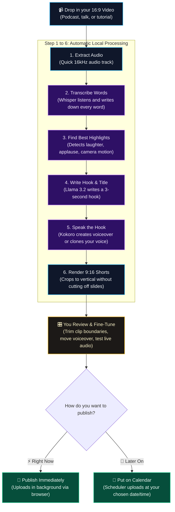
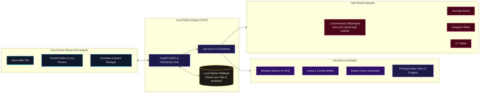
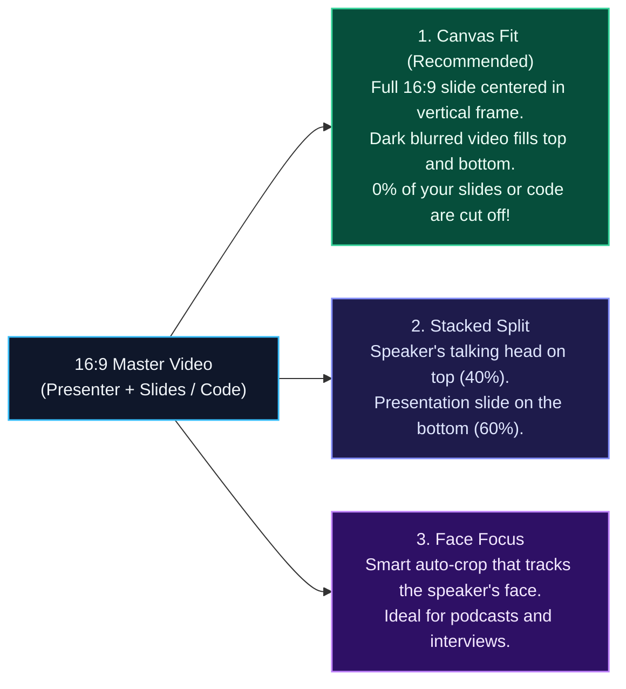
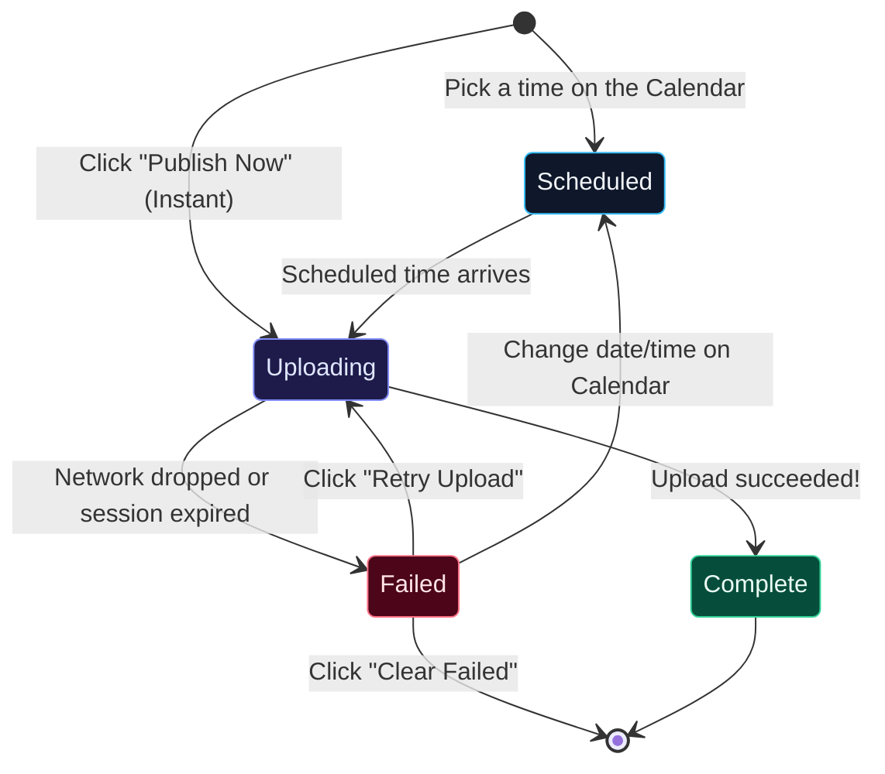

# 🎩 Alfred

> **Turn long-form videos into viral vertical shorts — 100% on your own computer.**  
> Zero cloud fees. Zero API keys. Zero monthly subscriptions. Your footage never leaves your machine.

---

## 📑 Table of Contents

- [What is Alfred?](#what-is-alfred)
- [How It Works in 6 Simple Steps](#how-it-works-in-6-simple-steps)
- [System Architecture (How the pieces connect)](#system-architecture-how-the-pieces-connect)
- [The 5 Local AI Models (Your On-Device Brain)](#the-5-local-ai-models-your-on-device-brain)
- [Key Features Explained Simply](#key-features-explained-simply)
  - [1. Presentation-Friendly 9:16 Video (No cut-off slides!)](#1-presentation-friendly-916-video-no-cut-off-slides)
  - [2. Multi-Track Timeline Editor (Like real editing software)](#2-multi-track-timeline-editor-like-real-editing-software)
  - [3. Clean Audio Routing (No voices talking over each other)](#3-clean-audio-routing-no-voices-talking-over-each-other)
  - [4. Clone Your Own Voice in 15 Seconds](#4-clone-your-own-voice-in-15-seconds)
  - [5. One-Click Publishing & Smart Calendar](#5-one-click-publishing-smart-calendar)
- [Hardware Requirements (Can my laptop run this?)](#hardware-requirements-can-my-laptop-run-this)
- [Quickstart Guide (Get running in 3 minutes)](#quickstart-guide-get-running-in-3-minutes)
- [Project Directory Tour](#project-directory-tour)
- [Simple API Reference](#simple-api-reference)
- [Frequently Asked Questions & Fixes](#frequently-asked-questions-fixes)
- [License](#license)

---

## 💡 What is Alfred?

If you have a 1-hour podcast, conference keynote, coding tutorial, or university lecture, turning it into 60-second vertical shorts for **YouTube Shorts, Instagram Reels, and TikTok** takes hours of tedious manual work:

1. You have to re-watch the whole video to find the best 30–60 second moments.
2. You have to crop horizontal 16:9 video into vertical 9:16. Most automatic tools blindly crop the center, which **cuts off 60% of your presentation slides, code editors, and charts**.
3. You have to write punchy title hooks, record voiceovers, and burn in subtitles.
4. You have to manually log into social media and upload each file.

**Alfred solves this automatically on your local machine:**
- **Finds the best moments** by analyzing where the speaker gets energetic, where people laugh or applaud, and where visual movement happens.
- **Protects your slides and code** by fitting the full presentation in the vertical frame with a clean blurred background, or splitting the screen between the speaker and the slides.
- **Writes & speaks viral opening hooks** using small local AI models so you grab the viewer's attention before they scroll away.
- **Gives you a real editor** with micro-frame nudges, draggable voiceover blocks, and live volume-ducked preview.
- **Publishes with 1 click** using your existing logged-in browser session—no expensive developer APIs or tokens needed.

---

## 🔄 How It Works in 6 Simple Steps

Here is the entire process from raw video to published vertical short:



---

## 🏛️ System Architecture (How the pieces connect)

Alfred is split into three simple parts:
1. **The Desktop & Web App**: Built with React 19, running fast in your browser or desktop window.
2. **The Local Server**: A lightweight Python service running on your machine at `http://127.0.0.1:8741`.
3. **The Local AI Engines & Browser**: Whisper, Llama, Kokoro, and Playwright doing the heavy lifting completely offline.



---

## 🧠 The 5 Local AI Models (Your On-Device Brain)

Alfred doesn't send your video to OpenAI, Google, or any cloud API. Everything runs directly on your CPU or graphics card using 5 specialized local models:

| Model Name | What it does in plain English | Size on Disk | How it helps your short |
|---|---|---|---|
| **Whisper (Base / Small)** | Listens to the video audio and writes down every word with exact timestamps. Uses voice-filtering so background music doesn't confuse it. | ~140 – 460 MB | Ensures clips start and end on complete sentences, never mid-word. |
| **Llama 3.2 (1B Instruct)** | Reads the spoken words and writes a 1–2 sentence verbal hook and a 3-to-7 word visual headline badge. | 771 MB | Grabs attention in the first 3 seconds so viewers don't scroll past. |
| **Kokoro-82M** | An ultra-fast local voice synthesizer that reads the hook out loud in 0.5 seconds. | 311 MB | Adds a professional studio voiceover without needing you to record audio manually. |
| **YOLOv8n-Face** | Looks at video frames and tracks where the speaker's face is moving in real-time. | 12 MB | Keeps the speaker's face centered when using talking-head vertical crop. |
| **OpenVoice v2** | An audio tone matcher that learns your vocal pitch from a 10-second reference sample. | 126 MB | Makes the AI voiceover sound like you instead of a robot. |

> 💡 **Check status anytime**: In Alfred, go to **Settings → AI Models** to verify that all 5 models are ready.

---

## ✨ Key Features Explained Simply

### 1. Presentation-Friendly 9:16 Video (No cut-off slides!)

Standard vertical tools crop the center of widescreen videos. If you are showing slides, code, or charts, 60% of the screen gets cut off. Alfred gives you 3 smart layout modes:



---

### 2. Multi-Track Timeline Editor (Like real editing software)

When you review a clip, you don't just get a simple slider. You get a professional multi-track console:

```mermaid
flowchart LR
    classDef track fill:#0f172a,stroke:#38bdf8,stroke-width:1.5px,color:#f1f5f9;
    classDef action fill:#1c1917,stroke:#fbbf24,stroke-width:1.5px,color:#fef3c7;
    classDef monitor fill:#064e3b,stroke:#34d399,stroke-width:1.5px,color:#ecfdf5;

    subgraph Sequencer ["Multi-Track Timeline View"]
        T_Ruler["Timecode Ruler: 00:00 ─────── 00:30 ─────── 01:00"]:::track
        T_V1["Track V1 (Video): [Storyboard Thumbnails + Active Clip Region]"]:::track
        T_A1["Track A1 (Audio): [🔊 Draggable Spoken Hook Block]"]:::track
    end

    subgraph Controls ["Tactile Controls"]
        Nudge["Micro-Nudge Buttons:\n[-5s] [-1s] [-1f]  and  [+1f] [+1s] [+5s]"]:::action
        Snap["Frame Snapping:\n[🚩 Set Start Here] and [🏁 Set End Here]"]:::action
        Scrub["Full-Length Scrubber:\nScrub anywhere across the whole source video"]:::action
    end

    subgraph Feedback ["Live Feedback"]
        LiveAudio["Live Ducked Preview:\nVideo volume automatically drops to 15%\nwhile the hook voiceover speaks"]:::monitor
        OneClick["Apply & Re-Render:\nRe-cuts and re-muxes your clip in ~15 seconds"]:::monitor
    end

    Controls --> Sequencer
    Sequencer --> Feedback
```



- **Frame-Accurate Stepping (`±1f`)**: Jump by exactly 1 single frame (0.033s at 30 fps) to cut right as someone finishes speaking.
- **Whole-Video Scrubbing**: Don't be trapped inside the clip boundaries. Scrub anywhere from 0:00 to the end of the video, and click "Set Start Here" or "Set End Here".
- **Constrained Voiceover Slider**: You can drag the voiceover to play at any second in the clip. Alfred guarantees it cannot drag past the end of the video.
- **Live Sound Ducking Preview**: When previewing in the browser, the video volume automatically dips down to 15% while the voiceover speaks, and smoothly rises back up when done!

---

### 3. Clean Audio Routing (No voices talking over each other)

Nothing sounds worse than an AI voiceover shouting over the original speaker. Alfred provides three clean audio modes:

```mermaid
flowchart TD
    classDef natural fill:#064e3b,stroke:#34d399,stroke-width:1.5px,color:#ecfdf5;
    classDef ducked fill:#1e1b4b,stroke:#818cf8,stroke-width:1.5px,color:#e0e7ff;
    classDef custom fill:#1c1917,stroke:#fbbf24,stroke-width:1.5px,color:#fef3c7;

    subgraph Mode1 ["Mode 1: Original Dialogue Only (Default)"]
        direction LR
        M1_In["Speaker Natural Audio (100% Volume)"]:::natural --> M1_Out["Clean Speech (Zero voiceover, zero ducking)"]:::natural
    end

    subgraph Mode2 ["Mode 2: Intro Hook at the Start"]
        direction LR
        M2_Hook["AI Hook speaks (t = 0.0s)"]:::ducked --> M2_Duck["Speaker volume dips to 15%"]:::ducked --> M2_Rec["Speaker smoothly recovers to 100%"]:::natural
    end

    subgraph Mode3 ["Mode 3: Custom Voiceover Placement"]
        direction LR
        M3_Start["Speaker at 100%"]:::natural --> M3_Window["Hook plays at your slider timestamp"]:::custom --> M3_Duck["Speaker dips to 15% during hook"]:::ducked --> M3_End["Speaker recovers to 100%"]:::natural
    end
```



---

### 4. Clone Your Own Voice in 15 Seconds

You don't need a robotic voice for your shorts:
1. Go to **Settings → Voice Cloning Studio**.
2. Click **Start Recording** and read the 10-second prompt into your microphone.
3. Listen back to ensure it sounds clear, then click **Save Sample**.
4. That's it! When Alfred writes hooks, it will synthesize them using your personal vocal tone.

---

### 5. One-Click Publishing & Smart Calendar

You don't need to apply for complicated YouTube API keys or pay for third-party social media schedulers:

- **⚡ Instant "Publish Now"**: Click the "Publish Now" button on any approved clip. Alfred immediately starts an automated background upload to YouTube Shorts, Instagram Reels, or X.
- **📅 Schedule for Later**: Pick a date and time. Alfred adds it to your visual calendar and automatically publishes it when the clock strikes that time.
- **🔄 Smart Error Recovery**: If your internet drops during upload, simply click **"Retry Upload"** or **"Retry All"** on the Calendar page.
- **Browser-Based Stealth**: Alfred uses a real Chromium browser session where you are already logged in. It moves the mouse, types like a human, and uploads directly through the web creator dashboard.



---

## ⚡ Hardware Requirements (Can my laptop run this?)

Yes! Alfred was specifically engineered to run on standard modern laptops without requiring a $2,000 graphics card.

| Component | Minimum | Recommended |
|---|---|---|
| **CPU** | 4 Cores (Intel 8th Gen+ or AMD Ryzen 3000+) | 8+ Cores (Apple Silicon M1/M2/M3/M4 or Intel Core i7 12th Gen+) |
| **RAM** | 8 GB | 16 GB |
| **GPU** | Built-in graphics (Intel Iris / AMD Radeon) | NVIDIA RTX 3060+ (faster rendering) or Apple Silicon |
| **Free Storage** | 10 GB on SSD | 25 GB on SSD (for video files and models) |
| **Operating System** | Linux (Ubuntu, Arch, Fedora), macOS 12+, or Windows 10/11 (WSL2) | Linux or macOS |

> 📊 **Real Memory Usage**: While processing a 10-minute video, Alfred uses only **1.8 GB to 2.4 GB of RAM**, so your computer won't freeze up while it works.

---

## 🚀 Quickstart Guide (Get running in 3 minutes)

### Step 1: Install System Tools
Make sure `ffmpeg` is installed on your computer:
```bash
# Ubuntu / Debian
sudo apt update && sudo apt install -y ffmpeg

# Arch Linux
sudo pacman -S ffmpeg

# macOS (Homebrew)
brew install ffmpeg
```

Make sure **uv** (the fast Python manager) is installed:
```bash
curl -LsSf https://astral.sh/uv/install.sh | sh
```

### Step 2: Clone the Project
```bash
git clone https://github.com/DivyamJoshi2005/Alfred.git
cd Alfred
```

### Step 3: Start the Backend Server
```bash
cd backend
uv sync
uv run python main.py
```
*The server will start at `http://127.0.0.1:8741` and automatically set up its database.*

### Step 4: Open the Studio Interface
Open your web browser and visit:  
👉 **`http://127.0.0.1:8741`**

*(Optional)* If you want to develop or edit the frontend code live with hot-reloading:
```bash
cd frontend
npm install
npm run dev
```

---

## 📁 Project Directory Tour

Here is what each folder in Alfred does:

```text
Alfred/
├── backend/                  # The Python server that runs AI & renders video
│   ├── main.py               # Starts the server and serves the web interface
│   ├── config.py             # System settings, model paths, and default ports
│   ├── database.py           # SQLite database setup (jobs, clips, schedule)
│   ├── pipeline/             # The 6 core processing steps
│   │   ├── transcriber.py    # Whisper speech-to-text
│   │   ├── multimodal_analyzer.py # Finds the best highlight moments
│   │   ├── hook_generator.py # Llama 3.2 hook script writer
│   │   ├── tts.py            # Kokoro voice generator
│   │   ├── voice_cloner.py   # OpenVoice voice clone matcher
│   │   ├── smart_crop.py     # YOLO face detection
│   │   └── assembler.py      # FFmpeg video slicer and crop renderer
│   ├── routers/              # API web routes (jobs, clips, schedule, accounts)
│   ├── scheduler/            # Background timer that triggers scheduled uploads
│   └── uploaders/            # Playwright browser scripts for YouTube, IG, and X
├── frontend/                 # The React 19 web application
│   ├── src/
│   │   ├── pages/            # The 4 main screens (Process, Review, Calendar, Settings)
│   │   ├── components/       # UI parts (Timeline Editor, Modals, Sidebar)
│   │   ├── lib/              # API helpers, formatters, and TypeScript types
│   │   └── App.tsx           # App routing and layout
├── models/                   # Folder where AI model weights live locally
└── dist/                     # The compiled production frontend
```

---

## 📡 Simple API Reference

For developers who want to control Alfred programmatically:

| Action | Route | What it does |
|---|---|---|
| **Upload video** | `POST /api/jobs/upload` | Send a video file to begin extracting highlights |
| **Get job status** | `GET /api/jobs/{id}` | Check progress (0% to 100%) and view extracted clips |
| **Get clips** | `GET /api/clips/job/{job_id}` | Get all candidate clips with their scores and storyboard images |
| **Re-render clip** | `POST /api/clips/{id}/rerender` | Re-render with new start/end time, framing mode, or audio mode |
| **Generate voice** | `POST /api/clips/{id}/synthesize-voice` | Generate speech audio for a hook using Kokoro or your cloned voice |
| **Publish right now** | `POST /api/schedule/publish-now` | Immediately trigger background upload to YouTube/Instagram/X |
| **Schedule for later**| `POST /api/schedule` | Queue a clip for future upload at a specific date & time |
| **Retry upload** | `POST /api/schedule/{id}/retry` | Retry a failed social media upload |
| **Connect account** | `POST /api/accounts/{platform}/connect`| Open browser window to log in to YouTube, IG, or X |
| **Check models** | `GET /api/settings/models` | Check if all 5 local AI models are downloaded and ready |
| **Live telemetry** | `WS /ws` | WebSocket channel streaming live progress percentages |

---

## ❓ Frequently Asked Questions & Fixes

### 1. Why does my upload fail with "Session expired or not logged in"?
Alfred uploads using your real browser session. If you haven't logged in yet:
1. Go to **Settings → Connected Accounts**.
2. Click **"Log In via Browser"** next to YouTube, Instagram, or X.
3. A real browser window will appear. Log into your account and wait until your creator dashboard loads.
4. Close the browser window.
5. Go back to the **Calendar** page and click **"Retry Upload"**.

### 2. Can I use Alfred completely without an internet connection?
**Yes!** Once the AI models are downloaded to your `models/` folder, the entire transcription, highlight scoring, voiceover generation, and 9:16 rendering pipeline runs 100% offline. You can edit videos on an airplane. Internet is only required when uploading to YouTube/Instagram/X.

### 3. What if it says "Port 8741 already in use"?
Another copy of the server is running in the background. Stop it with:
```bash
fuser -k 8741/tcp
```
Then start the server again with `uv run python main.py`.

### 4. Will my slides or code get cut off in vertical video?
**No!** Simply make sure the framing mode is set to **Canvas Fit** (which is the default). Canvas Fit places the full 16:9 widescreen presentation in the center and fills the empty top and bottom with a soft blurred background. 100% of your text, diagrams, and code remain fully legible.

---

## 📄 License

This project is open-source and released under the **MIT License**. See the [LICENSE](LICENSE) file for details.

---

<p align="center">
  <b>Alfred</b> — Built with care for video creators, educators, and technical speakers.
</p>
