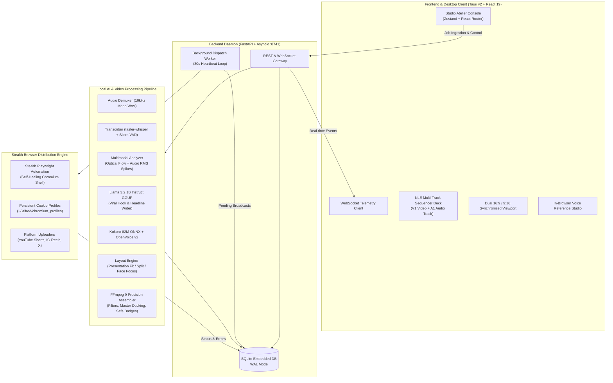

# 🎩 Alfred — Offline-First AI Content Repurposing & Distribution Engine

> Transform 60-minute long-form horizontal videos (keynotes, podcasts, technical talks, educational lectures) into high-retention, broadcast-ready 9:16 vertical shorts — 100% locally, with zero cloud API fees, zero telemetry, and complete data privacy.

---

## 📑 Table of Contents

- [Overview](#overview)
- [System Architecture](#system-architecture)
  - [High-Level Architecture Diagram](#high-level-architecture-diagram)
  - [Backend Daemon & Pipeline Flow](#backend-daemon-pipeline-flow)
  - [Frontend Studio Architecture](#frontend-studio-architecture)
- [Local AI Model Fleet](#local-ai-model-fleet)
- [End-to-End Processing Pipeline](#end-to-end-processing-pipeline)
  - [Stage 1: High-Fidelity Audio Demuxing](#stage-1-high-fidelity-audio-demuxing)
  - [Stage 2: Speech-to-Text with Silero VAD](#stage-2-speech-to-text-with-silero-vad)
  - [Stage 3: Multimodal Hook & Viral Retention Analysis](#stage-3-multimodal-hook-viral-retention-analysis)
  - [Stage 4: Attention Hook & Headline Generation](#stage-4-attention-hook-headline-generation)
  - [Stage 5: Kokoro-82M TTS & Cloned Narration Studio](#stage-5-kokoro-82m-tts-cloned-narration-studio)
  - [Stage 6: Multi-Framing Layout & Precision FFmpeg Assembly](#stage-6-multi-framing-layout-precision-ffmpeg-assembly)
- [Hardware-Style NLE Multi-Track Sequencer & Live Deck](#hardware-style-nle-multi-track-sequencer-live-deck)
  - [Multi-Track Sequencer Deck](#multi-track-sequencer-deck)
  - [Precision Micro-Stepping & Whole-Video Scrubbing](#precision-micro-stepping-whole-video-scrubbing)
  - [In-Browser Synchronized Audio Ducking Preview](#in-browser-synchronized-audio-ducking-preview)
- [Audio Master Routing & Dialogue Isolation](#audio-master-routing-dialogue-isolation)
- [Presentation-Aware 9:16 Framing Engine](#presentation-aware-916-framing-engine)
- [Distribution Engine: Instant Publish & Smart Calendar](#distribution-engine-instant-publish-smart-calendar)
  - [Instant "Publish Now" vs "Schedule for Later"](#instant-publish-now-vs-schedule-for-later)
  - [Queue Management & Failure Recovery](#queue-management-failure-recovery)
  - [Anti-Detection Stealth Playwright Automation](#anti-detection-stealth-playwright-automation)
  - [Self-Healing Browser Setup & Linux Wayland Support](#self-healing-browser-setup-linux-wayland-support)
- [Hardware Requirements & Performance Profiling](#hardware-requirements-performance-profiling)
- [Comprehensive Technologies Stack](#comprehensive-technologies-stack)
- [Repository Directory Structure](#repository-directory-structure)
- [Database Architecture & Persistence](#database-architecture-persistence)
- [Complete REST & WebSocket API Surface](#complete-rest-websocket-api-surface)
- [Installation & Quickstart Guide](#installation-quickstart-guide)
  - [1. Prerequisites](#1-prerequisites)
  - [2. Clone Repository](#2-clone-repository)
  - [3. Backend Setup (Python + uv)](#3-backend-setup-python-uv)
  - [4. Frontend Setup (React + Vite)](#4-frontend-setup-react-vite)
  - [5. Desktop Shell Setup (Tauri v2)](#5-desktop-shell-setup-tauri-v2)
- [Configuration & Environment Variables](#configuration-environment-variables)
- [Troubleshooting & FAQs](#troubleshooting-faqs)
- [License](#license)

---

## 💡 Overview

Producing vertical short-form video content (YouTube Shorts, Instagram Reels, TikTok, LinkedIn, X) from long-form technical lectures, keynotes, webinars, and podcasts is historically labor-intensive. Editors must manually scrub through hours of footage, hunt for engaging hooks, crop 16:9 widescreen footage into 9:16 vertical without cutting off slides or speaker faces, burn in subtitles, record voiceovers, and handle platform uploads.

**Alfred** automates this entire pipeline locally on your machine:
- **100% Offline & Private**: Powered by local ONNX models, local Whisper transcription, local GGUF LLMs, and local FFmpeg rendering. Your source video never leaves your workstation. Zero cloud API keys or monthly subscription fees.
- **Presentation-Aware Multi-Framing**: Solves the common vertical crop problem where technical slides, code editors, and presentation text get sliced off.
- **Zero Audio Collisions**: Clean separation between natural speaker dialogue and synthesized hook voiceovers.
- **Studio Editorial Deck**: Features a pro NLE multi-track sequencer with frame-accurate micro-stepping (`±1f`, `±1s`, `±5s`), whole-video timeline scrubbing, and live ducked audio preview.
- **Automated Social Distribution**: Upload immediately or schedule across platforms via stealth browser automation with persistent session authentication.

---

## 🏛️ System Architecture

Alfred combines a reactive **React 19 + TypeScript** frontend with an asynchronous **FastAPI + Python 3.10+** daemon, orchestrated by an embedded **SQLite (WAL mode)** database and a local media assembly engine.

### High-Level Architecture Diagram



---

### Backend Daemon & Pipeline Flow

The backend daemon (`backend/main.py`) coordinates pipeline execution asynchronously without blocking the web event loop:

```
┌────────────────────────────────────────────────────────────────────────────────────────┐
│                              FASTAPI ASYNC BACKEND DAEMON                              │
│                                                                                        │
│  [HTTP / REST GATEWAY]       [WEBSOCKET GATEWAY]       [BACKGROUND ENGINE]             │
│  POST /api/jobs/upload  ──►  ws://localhost:8741/ws ──► Pipeline Orchestrator          │
│  GET  /api/clips/job/{id}◄── Broadcast Stage Progress   (Async Worker Pool)            │
│  POST /api/clips/rerender    (0% → 100% telemetry)     │                               │
│  POST /api/schedule/publish-now                        ▼                               │
│                                                        [LOCAL AI ENGINE]               │
│  [PERSISTENCE LAYER]                                   1. FFmpeg Audio Demux (16kHz)   │
│  SQLite DB (~/.alfred/db/alfred.db)                    2. faster-whisper + Silero VAD  │
│  - jobs & transcripts tables                           3. Multimodal Energy Analyzer   │
│  - clips (metrics, framing, audio mode, storyboards)   4. Llama 3.2 1B Hook Writer     │
│  - scheduled_posts (status, attempts, last_error)      5. Kokoro-82M ONNX + Voice Clone│
│  - social_accounts (persistent Chromium sessions)      6. FFmpeg 9 Filtergraph Muxer   │
└────────────────────────────────────────────────────────────────────────────────────────┘
```

1. **Intake & Validation**: Receives video uploads or local file paths via `POST /api/jobs/upload`. Validates codecs, aspect ratios, and durations via `ffprobe`. Creates a job record in SQLite with status `queued`.
2. **Background Orchestration**: Dispatches an `asyncio.create_task()` running `pipeline/orchestrator.py`. The orchestrator locks project files under `~/Alfred/projects/{video_title}/`.
3. **Stage Execution & Event Streaming**: Progress events are published over WebSockets (`ws://127.0.0.1:8741/ws`) with stage names (`transcribing`, `analyzing`, `rendering`), 0–100 progress percentages, and log messages.
4. **Parameterized Non-Destructive Re-rendering**: When the creator tweaks start/end timecodes, audio modes, or hook placement in the review console, `POST /api/clips/{id}/rerender` re-executes only the assembly stage (~10–20 seconds) using targeted FFmpeg seek filters (`-ss`, `-to`).
5. **Background Distribution Worker**: `scheduler/worker.py` evaluates the `scheduled_posts` table every 30–60 seconds, launching stealth Playwright browser contexts for due posts.

---

### Frontend Studio Architecture

The frontend (`frontend/src/`) is built with React 19, TypeScript, and Tailwind CSS:

```
┌────────────────────────────────────────────────────────────────────────────────────────┐
│                         REACT 19 + TYPESCRIPT STUDIO ATELIER                           │
│                                                                                        │
│  [PAGE ROUTER]               [GLOBAL STATE & API]      [MODULAR COMPONENTS]            │
│  /process   (ProcessPage)    lib/api.ts                ClipTimelineEditor.tsx          │
│  /review    (ReviewPage)     context/WebSocketContext  Sidebar.tsx                     │
│  /calendar  (CalendarPage)   lib/types.ts              Modal.tsx                       │
│  /settings  (SettingsPage)                                                             │
│                                                                                        │
│  [EDITORIAL REVIEW CONSOLE]                                                            │
│  - Dual Viewport: 16:9 Original Master + 9:16 Vertical Cutdown                         │
│  - Interactive Multi-Track Sequencer: Timecode ruler, V1 Storyboard, A1 Hook Track     │
│  - Tactile Micro-Stepping: -5s, -1s, -1f, +1f, +1s, +5s frame-accurate nudges          │
│  - Unrestricted Video Scrubber: Scrub anywhere from 0:00 to video end                  │
│  - Mark In / Mark Out: "Set Start Here" & "Set End Here" frame snapping                │
│  - Audio Master Matrix: Original Audio / Intro Hook / Custom Timeline Voiceover        │
│  - Live Audio-Ducked Preview: Real-time volume ducking during in-browser preview       │
│  - One-Click Publishing: Instant "Publish Now" button + Schedule Modal toggle          │
└────────────────────────────────────────────────────────────────────────────────────────┘
```

---

## 🧠 Local AI Model Fleet

Alfred runs completely on-device. All 5 local AI models are managed and verified in `models/` and cached HuggingFace storage:

| Model | Architecture | Size | Role | Runtime | Hardware Acceleration |
|---|---|---|---|---|---|
| **Whisper Base.en / Small.en** | CTranslate2 INT8 | ~140 MB / ~460 MB | Studio speech transcription with word-level timestamps & Silero VAD | `faster-whisper` | CPU AVX2/AVX-512 & CUDA |
| **Llama 3.2 1B Instruct** | Q4_K_M GGUF | 771 MB | Viral highlight identification & contextual hook script generation | `llama-cpp-python` | Metal / CUDA / CPU BLAS |
| **Kokoro-82M** | StyleTTS2 ONNX | 311 MB | Ultra-fast text-to-speech narration (24kHz Mono) | `onnxruntime` | CPU & CUDA Execution Providers |
| **YOLOv8n-Face** | Dynamic 640×640 ONNX | 12.1 MB | Kinetic 9:16 smart cropping & face tracking | `onnxruntime` | Multithreaded frame inference |
| **OpenVoice v2** | PyTorch Checkpoint | 126 MB | Reference speaker tone converter & voice cloning | PyTorch / NumPy | CPU & CUDA |

> Model readiness can be verified at any time via `GET /api/settings/models`.

---

## 🔄 End-to-End Processing Pipeline

```mermaid
sequenceDiagram
    autonumber
    actor Creator as Content Creator
    participant Ingest as Ingest Bay (/process)
    participant Server as FastAPI Server (:8741)
    participant Engine as AI Pipeline Engine
    participant Deck as Editorial Console (/review)
    participant Dist as Distribution Engine

    Creator->>Ingest: Upload 16:9 Master Video (MP4 / MOV / MKV)
    Ingest->>Server: POST /api/jobs/upload
    Server-->>Ingest: Job created (ID) + WebSocket connection
    
    rect rgb(24, 26, 32)
        note over Server,Engine: 6-Stage Automated AI Extraction Pipeline
        Server->>Engine: Stage 1: Demux 16kHz Mono Audio (FFmpeg)
        Server->>Engine: Stage 2: Transcribe speech with word-level timestamps (faster-whisper + Silero VAD)
        Server->>Engine: Stage 3: Multimodal optical flow + audio RMS spike analysis
        Server->>Engine: Stage 4: Generate spoken hooks & visual headline badges (Llama 3.2 1B)
        Server->>Engine: Stage 5: Synthesize narration voice / cloned timbre (Kokoro-82M ONNX)
        Server->>Engine: Stage 6: Render initial 9:16 cutdowns (FFmpeg 9 Filtergraph)
    end

    Engine-->>Server: 5 candidate clips saved to SQLite
    Server-->>Ingest: WS Event: job_completed
    Ingest-->>Creator: Transition to Editorial Review Console (/review)

    Creator->>Deck: Fine-tune In/Out points using NLE Sequencer & ±1f micro-nudges
    Creator->>Deck: Select Audio Routing (Original / Intro Hook / Custom Voiceover)
    Creator->>Deck: Adjust Voiceover placement slider on timeline
    Creator->>Deck: Click "Apply & Re-render Clip"
    Deck->>Server: POST /api/clips/{id}/rerender
    Server-->>Deck: Re-rendered clip ready in ~15 seconds

    alt Instant Upload
        Creator->>Deck: Click "Publish Now"
        Deck->>Server: POST /api/schedule/publish-now
        Server->>Dist: Trigger immediate background upload via stealth browser
    else Scheduled Post
        Creator->>Deck: Click "Schedule Post"
        Deck->>Server: POST /api/schedule
        Server-->>Deck: Added to Broadcast Calendar (/calendar)
    end
```



### Stage 1: High-Fidelity Audio Demuxing
- Uses direct FFmpeg stream extraction to demux the master audio track into a pristine 16kHz mono WAV file:
  ```bash
  ffmpeg -y -i input.mp4 -vn -acodec pcm_s16le -ar 16000 -ac 1 audio.wav
  ```
- Operates at negligible CPU overhead (~0.8s for a 10-minute video).

### Stage 2: Speech-to-Text with Silero VAD
- **`faster-whisper` (Base.en / Small.en)**: Uses CTranslate2 INT8 quantization for fast, accurate speech recognition.
- **5-Path Beam Search**: Accurately recognizes technical terminology, proper nouns, and fast speakers.
- **Silero Voice Activity Detection (VAD)**: Strictly gates transcription to human speech segments, completely preventing music and background silence hallucinations.
- Generates granular word-level timestamps essential for precise clip boundary snapping.

### Stage 3: Multimodal Hook & Viral Retention Analysis
Alfred does not rely solely on text keywords. The multimodal analyzer (`pipeline/multimodal_analyzer.py`) combines visual, acoustic, and linguistic cues:
1. **Optical Flow Motion Energy**: Samples frames at 2 fps using OpenCV Farneback dense optical flow to detect visual movement and scene transitions.
2. **Dynamic Audio RMS Spikes**: Analyzes root-mean-square audio energy contrast to catch high-arousal acoustic events (laughter, audience applause, enthusiastic vocal swells, dramatic pauses).
3. **Scene-Cut Boundary Anchoring**: Detects camera shot transitions to anchor clip start points naturally.
4. **4-Frame Visual Hook Storyboards**: Automatically captures storyboard frames at `+0.0s`, `+1.0s`, `+2.0s`, and `+3.0s` to verify the opening visual energy.
5. **Calibrated Viral Retention Scores (0–100%)**: Computes a non-linear percentile index where top highlight moments achieve 88%–96% predicted retention, accompanied by clear human-readable narrative rationales.

### Stage 4: Attention Hook & Headline Generation
- **Local Llama 3.2 1B Instruct**: Generates high-converting hook scripts tailored to the clip's transcript:
  - **Spoken Hook**: A natural 1–2 sentence verbal intro designed to tease the core insight.
  - **Visual Headline**: A punchy 3–7 word uppercase headline badge placed in the upper 22% safe-zone.
- Robust heuristic fallback ensures hook generation succeeds even without local LLM weights.

### Stage 5: Kokoro-82M TTS & Cloned Narration Studio
- **Kokoro-82M ONNX**: 82-million parameter local TTS model with natural phrasing and human prosody at 24kHz.
- **Voice Presets**: High-fidelity voices including `Heart` (warm & engaging), `Bella` (clear & upbeat), `Nicole` (relaxed), `Adam` (confident), and `Michael` (deep & grounded).
- **In-Browser Reference Voice Recorder**: Record 10–15s reference samples with your microphone directly from Settings.
- **OpenVoice v2 Tone Conversion**: Extracts speaker acoustic embeddings and transfers personal timbre to generated hooks offline.

### Stage 6: Multi-Framing Layout & Precision FFmpeg Assembly
- Assembles final vertical reels (1080×1920) using FFmpeg 9 filtergraphs:
  - Scales and centers 16:9 footage with dark blurred background fill (`presentation_fit`), stacked dual viewports (`split_screen`), or face-tracked crop (`face_focus`).
  - Burns high-contrast visual headline badge into the upper safe zone.
  - Mixes audio according to the active audio routing mode with smooth volume curves.

---

## 🎛️ Hardware-Style NLE Multi-Track Sequencer & Live Deck

The Editorial Review Console (`frontend/src/components/ClipTimelineEditor.tsx`) gives creators professional NLE capabilities inside the browser:

```
┌────────────────────────────────────────────────────────────────────────────────────────┐
│                        NLE MULTI-TRACK SEQUENCER & LIVE DECK                           │
│                                                                                        │
│  [TIMECODE RULER]  00:00        00:15        00:30        00:45        01:00        │
│  ├───┼───┼───┼───┼───┼───┼───┼───┼───┼───┼───┼───┼───┼───┼───┼───┼───┼───┼───┼───┤   │
│                                                                                        │
│  [V1 VIDEO TRACK]  [======== ACTIVE CLIP REGION (00:12.4 - 00:48.2) ========]          │
│                    Thumbnails: [+0.0s]      [+1.0s]      [+2.0s]      [+3.0s]          │
│                                                                                        │
│  [A1 HOOK TRACK]          [🔊 Spoken Hook Block (3.2s)]                                │
│                           ▲ Drag / Slide offset anywhere inside clip boundaries        │
│                                                                                        │
│  [SCRUBBER BAR]    Scrub position: 00:24.8 / 01:14.2  [► Play / Pause] [↺ Loop Clip]   │
│                                                                                        │
│  [SNAP CONTROLS]   [🚩 Set Start Here]                [🏁 Set End Here]                 │
│  [MICRO-NUDGES]    Start: [-5s] [-1s] [-1f] [+1f] [+1s] [+5s]                          │
│                    End:   [-5s] [-1s] [-1f] [+1f] [+1s] [+5s]                          │
└────────────────────────────────────────────────────────────────────────────────────────┘
```

### Multi-Track Sequencer Deck
- **Visual Timecode Ruler**: Dynamic second markers scaling between focused clip view and full video overview.
- **Video Track (V1)**: Visualizes the active clip region against the parent video, featuring storyboard thumbnail previews.
- **Voice Hook Track (A1)**: Interactive audio block representing the synthesized spoken hook.
- **Strict Boundary Constraint**: The hook block is strictly constrained within clip boundaries (`0 <= offset <= clip_duration - hook_duration`), preventing voiceover bleed past clip end.

### Precision Micro-Stepping & Whole-Video Scrubbing
- **Frame-Accurate Micro-Stepping**:
  - `±1f`: Single frame step at 30 fps (~0.033 seconds) for sample-accurate cuts.
  - `±1s`: Second jump for quick pacing adjustments.
  - `±5s`: Five-second jump for rapid traversal.
- **Unrestricted Video Scrubber**: Scrub anywhere across the entire video duration—not limited to the current clip slice.
- **Frame Snapping**: "Set Start Here" and "Set End Here" snap clip boundaries directly to the current playhead position.

### In-Browser Synchronized Audio Ducking Preview
- When previewing clips in the browser with `intro_hook` or `custom_voiceover`, Alfred dynamically monitors video playhead position.
- Video audio volume is smoothly ducked (to 15%) while the spoken hook audio plays, and automatically recovered when the hook finishes.

---

## 🎙️ Audio Master Routing & Dialogue Isolation

Alfred eliminates awkward voice collisions between synthetic AI narration and the video's original speaker:

| Mode | Identifier | Behavior | Ideal Use Case |
|---|---|---|---|
| **Original Sound Only** | `original` | 100% pure source dialogue. Zero AI voiceover, zero audio ducking, zero overlays. | Standalone speeches, funny moments, self-explanatory clips. |
| **Intro Hook at Start** | `intro_hook` | Spoken hook plays at clip start (`t=0.0s`). Source audio ducks to 15% with smooth recovery. | Fast-paced viral shorts needing an immediate verbal grabber. |
| **Timeline Voiceover** | `custom_voiceover` | Spoken hook placed at creator-defined timeline offset (`hook_offset_sec`) with dynamic window ducking. | Dramatic commentary or context explanation over b-roll. |

---

## 📐 Presentation-Aware 9:16 Framing Engine

Traditional vertical tools center-crop 16:9 video, cutting off up to 60% of presentation slides, code editors, and diagrams. Alfred offers three intelligent framing layouts:

```
┌──────────────────┐  ┌──────────────────┐  ┌──────────────────┐
│ [ Blurred Fill ] │  │ [ Speaker Head ] │  │                  │
│ ┌──────────────┐ │  │ ┌──────────────┐ │  │   YOLOv8n-Face   │
│ │ 16:9 Master  │ │  │ │  1080 × 720  │ │  │   Dynamic Crop   │
│ │ Presentation │ │  │ └──────────────┘ │  │   Tracks Speaker │
│ └──────────────┘ │  │ [ Slides Window] │  │                  │
│ [ Blurred Fill ] │  │ ┌──────────────┐ │  │                  │
│                  │  │ │  1080 × 1200 │ │  │                  │
│                  │  │ └──────────────┘ │  │                  │
└──────────────────┘  └──────────────────┘  └──────────────────┘
  Canvas Fit (Fit)     Stacked Split (Split)   Face Focus (Crop)
```

1. **Canvas Fit (`presentation_fit`)**: Places the full 16:9 canvas in the center with a subtle dark blurred background fill. **100% of slides, code, equations, and subtitles remain visible.**
2. **Stacked Split (`split_screen`)**: Vertically stacks the speaker's talking head on top and the presentation slide on the bottom.
3. **Face Focus (`face_focus`)**: Tracks the speaker's face with YOLOv8n-Face ONNX to produce a centered 9:16 crop for talking-head-only segments.

---

## 🚀 Distribution Engine: Instant Publish & Smart Calendar

Alfred includes an offline-first social distribution system that bypasses official developer API restrictions, token expirations, and platform developer review processes.

### Instant "Publish Now" vs "Schedule for Later"
- **⚡ Instant "Publish Now"**: 1-click button on clip cards (`POST /api/schedule/publish-now`). Immediately queues the clip and triggers an asynchronous background upload task.
- **📅 Schedule for Later**: The schedule modal lets you switch between immediate publication and scheduled publication with custom dates, titles, descriptions, and hashtags.

### Queue Management & Failure Recovery
The Broadcast Calendar (`frontend/src/pages/CalendarPage.tsx`) provides complete queue control:
- **🔄 Retry Upload**: 1-click retry on individual failed posts (`POST /api/schedule/{post_id}/retry`), resetting attempt counters and launching the uploader immediately.
- **⚡ Retry All Failed**: Bulk retry button (`POST /api/schedule/retry-all`) for batch recovery after network re-connection.
- **🗑️ Clear All Failed**: Bulk purge (`DELETE /api/schedule/failed`) to keep the queue clean.
- **Auto-Rescheduling**: Rescheduling a failed post via `PATCH /api/schedule/{post_id}` automatically resets failure state and clears error messages.

### Anti-Detection Stealth Playwright Automation
- **Persistent Browser Profiles**: Browser sessions and cookies are stored in `~/.alfred/chromium_profiles/{platform}`.
- **Anti-Bot Hardening**:
  - Masks `navigator.webdriver`.
  - Mocks `window.chrome`, browser plugins, languages, and notification permissions.
  - Humanized variable typing cadence (40–120ms per key with natural micro-pauses).
  - Randomized click delays and mouse hover simulations.
- **Interactive Browser Authentication**: `POST /api/accounts/{platform}/connect` opens a visible browser window for manual login, monitors authentication success, and persists cookies automatically.
- **Live Session Health Check**: `GET /api/accounts/{platform}/status` verifies whether saved cookies are still authenticated.

### Self-Healing Browser Setup & Linux Wayland Support
- **Automatic Self-Healing**: `ensure_playwright_browsers()` in `uploaders/stealth.py` automatically checks and installs Chromium browser binaries via `playwright install chromium` if missing.
- **Linux Compatibility Flags**: Launch configurations include `--ozone-platform-hint=auto`, `--ignore-certificate-errors`, and `--no-sandbox` to run seamlessly across Wayland and X11 desktops (KDE Plasma, GNOME, etc.).

---

## ⚡ Hardware Requirements & Performance Profiling

Alfred is designed to run efficiently on standard developer workstations without cloud GPUs:

### System Hardware Specifications

| Component | Minimum Specification | Recommended Specification |
| :--- | :--- | :--- |
| **Processor (CPU)** | 4 Cores (Intel 8th Gen+ / AMD Ryzen 3000+) | 8+ Cores (Apple Silicon M-Series or Intel 12th Gen+ / AMD Ryzen 5000+) |
| **System Memory (RAM)** | 8 GB RAM | 16 GB – 32 GB RAM |
| **Graphics (GPU / VRAM)** | Integrated Graphics | NVIDIA RTX 3060+ (6 GB+ VRAM) or Apple Silicon Unified Memory |
| **Disk Storage** | 10 GB free space on SSD | 25 GB+ free space on NVMe SSD |
| **Operating System** | Linux (Ubuntu 20.04+, Arch, Fedora), macOS 12+, Windows 10/11 (WSL2) | Arch Linux, Ubuntu 22.04 LTS, or macOS Sonoma / Sequoia |

### Per-Component Resource Footprint

| Pipeline Stage | Model Architecture | RAM Usage | VRAM Usage | Latency (10-min Video Input) | Hardware Optimization |
| :--- | :--- | :--- | :--- | :--- | :--- |
| **1. Audio Demux** | FFmpeg Direct Stream | ~50 MB | 0 MB | ~0.8s | Stream copy (`-vn -ac 1 -ar 16000`) |
| **2. Speech-to-Text** | `faster-whisper` (`base`/`small`) | ~1.1 GB | ~850 MB | ~28–45s (CPU) / ~8–12s (CUDA) | CTranslate2 INT8, AVX2 SIMD |
| **3. Highlight Ranker** | Multimodal Flow + RMS | ~150 MB | 0 MB | ~1.2s | NumPy vectorized scoring |
| **4. Hook Generator** | Llama 3.2 1B GGUF | ~600 MB | ~700 MB | ~1.5s | Q4_K_M quantization |
| **5. Kokoro-82M TTS** | StyleTTS2 ONNX | ~380 MB | ~300 MB | ~0.5s per 5s audio | ONNX Runtime CPU/CUDA |
| **6. Voice Cloner** | OpenVoice v2 | ~180 MB | ~100 MB | ~0.3s per slice | Cosine embedding alignment |
| **7. Smart Crop** | YOLOv8n-Face ONNX | ~220 MB | ~150 MB | 60+ FPS | Multithreaded frame inference |
| **8. Video Assembler** | FFmpeg 9 Filtergraph | ~450–750 MB | Optional NVENC | ~15–25s per 45s reel | Multithreaded libx264 |

> **Total Peak Memory**: The entire daemon operates within **1.8 GB to 2.4 GB RAM**, running smoothly alongside your IDE and browser.

---

## 🛠️ Comprehensive Technologies Stack

| Layer | Technology | Version | Purpose & Rationale |
| :--- | :--- | :--- | :--- |
| **Desktop Shell** | [Tauri](https://tauri.app/) | `v2.0` | Native OS windowing with minimal memory footprint (< 15MB binary vs 150MB+ Electron). |
| **Desktop Language** | [Rust](https://www.rust-lang.org/) | `1.77+` | Memory-safe window management and native system file dialogs. |
| **Frontend Framework** | [React](https://react.dev/) | `19.0` | Modern reactive UI utilizing Concurrent Mode for fluid playback and timeline rendering. |
| **Frontend Language** | [TypeScript](https://www.typescriptlang.org/) | `5.8` | Strict end-to-end type safety for jobs, clips, timecodes, framing modes, and WebSocket events. |
| **Styling & Icons** | Tailwind CSS & Lucide Icons | Latest | Studio Atelier hardware design system styling with responsive Lucide iconography. |
| **Build Tooling** | [Vite](https://vitejs.dev/) | `7.3` | Ultra-fast ESM compilation and Hot Module Replacement. |
| **State Management** | [Zustand](https://zustand.docs.pmnd.rs/) | `5.0` | Decoupled global state stores. |
| **Backend Framework** | [FastAPI](https://fastapi.tiangolo.com/) | `0.115` | High-concurrency asynchronous Python ASGI web framework with OpenAPI docs. |
| **Async Server** | [Uvicorn](https://www.uvicorn.org/) | `0.34` | Lightning-fast ASGI production server with WebSocket protocol support. |
| **Package Manager** | [uv](https://astral.sh/uv) | Latest | Fast Rust-based Python package manager and deterministic virtual environment orchestrator. |
| **Embedded Database** | [SQLite](https://www.sqlite.org/) | `3.45+` | File-based embedded relational database with zero external dependencies. |
| **Async DB Driver** | [aiosqlite](https://aiosqlite.omnilib.dev/) | `0.20` | Non-blocking asynchronous SQLite bindings with WAL journal mode. |
| **Schema Validation** | [Pydantic](https://docs.pydantic.dev/) | `v2.10` | Fast data validation, request sanitization, and JSON schema generation. |
| **Speech-to-Text** | [faster-whisper](https://github.com/SYSTRAN/faster-whisper) | `1.1` | Whisper implementation using CTranslate2 INT8 quantization, 5-beam search & Silero VAD. |
| **LLM Inference** | [llama-cpp-python](https://github.com/abetlen/llama-cpp-python) | `0.3.7` | Local Llama 3.2 1B Instruct GGUF runtime for viral highlight ranking and hook writing. |
| **Voice Synthesis** | [Kokoro-82M](https://huggingface.co/hexgrad/Kokoro-82M) | `0.19 ONNX` | 82M parameter local TTS model with natural phrasing and human prosody. |
| **Voice Cloning** | [OpenVoice v2](https://github.com/myshell-ai/OpenVoice) | `v2.0` | Speaker tone converter transferring acoustic embeddings to synthesized narration offline. |
| **Neural Runtime** | [ONNX Runtime](https://onnxruntime.ai/) | `1.20` | Cross-platform neural inference engine optimized for CPU and CUDA backends. |
| **Computer Vision** | [YOLOv8n-Face](https://github.com/akanametov/yolo-face) & OpenCV | `1.0` / `4.10` | Real-time face detection, dynamic 9:16 framing tracking, and optical-flow motion analysis. |
| **Media Processing** | [FFmpeg](https://ffmpeg.org/) & [FFprobe](https://ffmpeg.org/) | `6.0+` / `9.0+` | Video slicing, aspect ratio transformation, audio sidechain ducking, and subtitle rendering. |
| **Browser Automation** | [Playwright](https://playwright.dev/) | `1.50+` | Headless/interactive browser automation with stealth fingerprint masking for social uploads. |

---

## 📁 Repository Directory Structure

```text
Alfred/
├── backend/                              # FastAPI Python backend daemon
│   ├── main.py                           # FastAPI application entry point & static SPA server
│   ├── config.py                         # System paths, server ports, and model configurations
│   ├── database.py                       # SQLite schema, async connection pool, and migrations
│   ├── models/                           # Pydantic schemas (Job, Clip, Schedule, Account)
│   │   ├── __init__.py
│   │   ├── job.py
│   │   └── schedule.py
│   ├── pipeline/                         # Core local AI processing pipeline
│   │   ├── orchestrator.py               # Multi-stage automated pipeline coordinator
│   │   ├── transcriber.py                # Speech-to-text engine (faster-whisper + Silero VAD)
│   │   ├── analyzer.py                   # Highlight ranker & viral scoring algorithms
│   │   ├── multimodal_analyzer.py        # Optical flow motion, RMS energy & storyboards
│   │   ├── hook_generator.py             # Spoken & visual attention hook generator (Llama 3.2)
│   │   ├── tts.py                        # Kokoro-82M ONNX Text-to-Speech engine
│   │   ├── voice_cloner.py               # OpenVoice v2 tone converter
│   │   ├── smart_crop.py                 # YOLOv8n-Face tracking & 9:16 layout logic
│   │   └── assembler.py                  # FFmpeg 9 video slicer, master ducking & overlays
│   ├── routers/                          # REST & WebSocket API endpoints
│   │   ├── jobs.py                       # Video upload, intake jobs, & telemetry
│   │   ├── clips.py                      # Clip fine-tuning, re-rendering & voice synthesis
│   │   ├── schedule.py                   # Calendar queue, retry logic, & instant publish
│   │   ├── accounts.py                   # Interactive stealth browser login & session checks
│   │   ├── settings.py                   # Model readiness checks & voice reference studio
│   │   └── ws.py                         # Real-time WebSocket telemetry gateway
│   ├── scheduler/                        # Background broadcast scheduler
│   │   └── worker.py                     # Cron loop polling due posts and dispatching uploads
│   ├── uploaders/                        # Social platform automation adapters
│   │   ├── base.py                       # Abstract base uploader interface
│   │   ├── stealth.py                    # Anti-detection stealth scripts & browser installer
│   │   ├── youtube.py                    # YouTube Studio Shorts uploader
│   │   ├── instagram.py                  # Instagram Reels uploader
│   │   └── twitter.py                    # X (Twitter) video uploader
│   ├── pyproject.toml                    # Python package dependencies managed by uv
│   └── uv.lock                           # Deterministic dependency lockfile
├── frontend/                             # Primary frontend application (React 19 + TypeScript + Vite)
│   ├── src/
│   │   ├── pages/                        # Primary application screens
│   │   │   ├── ProcessPage.tsx           # Ingestion Bay & live telemetry stream
│   │   │   ├── ReviewPage.tsx            # Editorial Review Console & clip fine-tuning
│   │   │   ├── CalendarPage.tsx          # Broadcast Calendar, retry deck & queue management
│   │   │   └── SettingsPage.tsx          # AI models readiness, accounts & voice recorder
│   │   ├── components/                   # Core modular components
│   │   │   ├── ClipTimelineEditor.tsx    # NLE multi-track sequencer deck & live video monitor
│   │   │   ├── Sidebar.tsx               # Primary navigation sidebar
│   │   │   └── Modal.tsx                 # Reusable accessible modal dialog
│   │   ├── context/                      # React contexts
│   │   │   └── WebSocketContext.tsx      # Global WebSocket telemetry provider
│   │   ├── hooks/                        # Custom React hooks
│   │   │   └── useWebSocket.ts           # Auto-reconnecting WebSocket hook
│   │   ├── lib/                          # Client libraries & utilities
│   │   │   ├── api.ts                    # Typed API client for all backend REST endpoints
│   │   │   ├── types.ts                  # TypeScript domain models (Job, Clip, Schedule, etc.)
│   │   │   └── utils.ts                  # Timecode formatters, classnames (cn)
│   │   ├── App.tsx                       # Root layout & route definitions
│   │   ├── App.css                       # Studio Atelier layout styles
│   │   ├── index.css                     # Tailwind CSS design system tokens
│   │   └── main.tsx                      # Vite React entry point
│   ├── package.json                      # Frontend dependencies & scripts
│   ├── vite.config.ts                    # Vite compilation config & API proxying
│   └── tsconfig.json                     # TypeScript compiler configuration
├── models/                               # Local AI model weights directory
│   ├── llama-3.2-1b.Q4_K_M.gguf          # Llama 3.2 1B Instruct GGUF
│   ├── kokoro-82m.onnx                   # Kokoro-82M ONNX TTS
│   ├── voices.bin / voices.json          # Kokoro voice embedding weights
│   ├── yolov8n-face.onnx                 # YOLOv8n face detection model
│   └── xtts-v2/ / openvoice/             # Speaker tone converter models
├── src-tauri/                            # Native desktop shell (Tauri v2 + Rust)
│   ├── Cargo.toml                        # Rust dependencies
│   ├── tauri.conf.json                   # Desktop window configuration & permissions
│   └── src/main.rs                       # Rust desktop entry point
├── dist/                                 # Compiled production frontend build
└── README.md                             # Master project documentation
```

---

## 🗄️ Database Architecture & Persistence

Alfred uses an embedded SQLite database with Write-Ahead Logging (`PRAGMA journal_mode=WAL`) located at `~/.alfred/db/alfred.db`:

```sql
-- Core job tracking
CREATE TABLE jobs (
    id          TEXT PRIMARY KEY,
    video_path  TEXT NOT NULL,
    video_name  TEXT NOT NULL,
    status      TEXT NOT NULL DEFAULT 'queued',
    created_at  DATETIME DEFAULT CURRENT_TIMESTAMP,
    updated_at  DATETIME DEFAULT CURRENT_TIMESTAMP,
    error_msg   TEXT
);

-- Whisper transcription output
CREATE TABLE transcripts (
    id          TEXT PRIMARY KEY,
    job_id      TEXT NOT NULL REFERENCES jobs(id) ON DELETE CASCADE,
    full_text   TEXT NOT NULL,
    segments    TEXT NOT NULL,
    words       TEXT NOT NULL,
    created_at  DATETIME DEFAULT CURRENT_TIMESTAMP
);

-- AI-identified clip segments & editorial parameters
CREATE TABLE clips (
    id                    TEXT PRIMARY KEY,
    job_id                TEXT NOT NULL REFERENCES jobs(id) ON DELETE CASCADE,
    rank                  INTEGER NOT NULL,
    start_time            REAL NOT NULL,
    end_time              REAL NOT NULL,
    duration              REAL NOT NULL,
    transcript_text       TEXT NOT NULL,
    hook_text             TEXT,
    hook_audio_path       TEXT,
    output_path           TEXT,
    status                TEXT DEFAULT 'pending',
    rationale             TEXT,
    visual_score          REAL DEFAULT 0.0,
    audio_score           REAL DEFAULT 0.0,
    hook_score            REAL DEFAULT 0.0,
    retention_score       REAL DEFAULT 0.0,
    visual_hook_rationale TEXT,
    storyboard_paths      TEXT,
    audio_mode            TEXT DEFAULT 'original',
    hook_offset_sec       REAL DEFAULT 0.0,
    created_at            DATETIME DEFAULT CURRENT_TIMESTAMP
);

-- Scheduled & published social posts
CREATE TABLE scheduled_posts (
    id              TEXT PRIMARY KEY,
    clip_id         TEXT NOT NULL REFERENCES clips(id) ON DELETE CASCADE,
    platform        TEXT NOT NULL,
    scheduled_at    DATETIME NOT NULL,
    title           TEXT,
    description     TEXT,
    tags            TEXT,
    status          TEXT DEFAULT 'scheduled',
    attempts        INTEGER DEFAULT 0,
    last_error      TEXT,
    created_at      DATETIME DEFAULT CURRENT_TIMESTAMP,
    updated_at      DATETIME DEFAULT CURRENT_TIMESTAMP
);

-- Authenticated browser sessions
CREATE TABLE social_accounts (
    id              TEXT PRIMARY KEY,
    platform        TEXT NOT NULL UNIQUE,
    profile_path    TEXT NOT NULL,
    display_name    TEXT,
    connected_at    DATETIME DEFAULT CURRENT_TIMESTAMP,
    last_used_at    DATETIME
);
```

---

## 📡 Complete REST & WebSocket API Surface

The backend daemon exposes a comprehensive REST and WebSocket interface:

### 1. Ingestion & Jobs (`/api/jobs`)
| Method | Endpoint | Request Body | Description |
|---|---|---|---|
| `POST` | `/api/jobs/upload` | Multipart: `file: UploadFile`, `clip_count: int` | Ingest long-form video file and trigger background pipeline |
| `GET` | `/api/jobs` | — | List all historical ingestion jobs |
| `GET` | `/api/jobs/{job_id}` | — | Retrieve job details, telemetry status, and clip list |
| `DELETE`| `/api/jobs/{job_id}` | — | Delete job and remove associated video assets from disk |
| `POST` | `/api/jobs/{job_id}/cancel` | — | Cancel an in-progress pipeline job |

### 2. Clips & Editorial Deck (`/api/clips`)
| Method | Endpoint | Request Body | Description |
|---|---|---|---|
| `GET` | `/api/clips/{clip_id}` | — | Retrieve clip metadata, scores, and paths |
| `GET` | `/api/clips/job/{job_id}`| — | Retrieve all candidate clips for a specific job |
| `PATCH` | `/api/clips/{clip_id}` | `{status, hook_text, start_time, end_time, audio_mode, hook_offset_sec}` | Update clip approval status, hook text, or trim boundaries |
| `POST` | `/api/clips/{clip_id}/rerender` | `{start_time, end_time, framing_mode, audio_mode, hook_offset_sec}` | Re-assemble clip with custom trim boundaries, framing, or audio ducking |
| `POST` | `/api/clips/{clip_id}/synthesize-voice` | `{text, voice_preset, use_voice_clone, sample_name}` | Synthesize Kokoro or cloned voiceover track |

### 3. Distribution & Schedule (`/api/schedule`)
| Method | Endpoint | Request Body | Description |
|---|---|---|---|
| `POST` | `/api/schedule/publish-now` | `{clip_id, platform, title, description, tags}` | **Immediately upload clip right now** in the background |
| `POST` | `/api/schedule` | `{clip_id, platform, scheduled_at, title, description, tags}` | Schedule a clip for future publication |
| `GET` | `/api/schedule` | Query: `from_date`, `to_date` | Retrieve scheduled calendar posts |
| `PATCH` | `/api/schedule/{post_id}` | `{scheduled_at, title, description, tags, status}` | Reschedule post or update metadata (resets failures) |
| `POST` | `/api/schedule/{post_id}/retry` | — | Reset a failed post to scheduled and trigger immediate upload |
| `POST` | `/api/schedule/retry-all` | — | Reset all failed posts and trigger immediate uploads |
| `DELETE`| `/api/schedule/failed` | — | Bulk delete all failed scheduled posts |
| `DELETE`| `/api/schedule/{post_id}` | — | Cancel and delete a specific scheduled post |

### 4. Social Accounts & Stealth Auth (`/api/accounts`)
| Method | Endpoint | Query / Body | Description |
|---|---|---|---|
| `GET` | `/api/accounts` | — | List all connected social account profiles |
| `GET` | `/api/accounts/{platform}/status` | — | Check whether saved browser session cookies are still authenticated |
| `POST` | `/api/accounts/{platform}/connect` | Query: `interactive: bool` | Launch visible browser window for manual login and capture session |
| `DELETE`| `/api/accounts/{platform}` | — | Disconnect platform account and delete local profile |

### 5. Settings & Local AI Studio (`/api/settings`)
| Method | Endpoint | Request Body | Description |
|---|---|---|---|
| `GET` | `/api/settings` | — | Retrieve system configuration and preferences |
| `POST` | `/api/settings` | Key-value settings object | Update application configuration |
| `GET` | `/api/settings/models` | — | Retrieve local readiness status of all 5 local AI models |
| `GET` | `/api/settings/voice-samples` | — | List recorded/uploaded voice cloning reference samples |
| `POST` | `/api/settings/voice-sample` | Multipart: `file: UploadFile` | Upload or save in-browser mic recording as reference sample |
| `DELETE`| `/api/settings/voice-samples/{filename}` | — | Delete a stored voice cloning sample |

### 6. Media Streaming & Telemetry
| Protocol | Endpoint | Description |
|---|---|---|
| `GET` | `/api/media?path=...` | Byte-range video and storyboard frame streaming endpoint (`Accept-Ranges: bytes`) |
| `GET` | `/api/health` | System health check, database status, and uptime |
| `WS` | `/ws` | Real-time bi-directional pipeline telemetry channel |

---

## 🚀 Installation & Quickstart Guide

### 1. Prerequisites
- **Operating System**: Linux (Ubuntu 20.04+, Arch, Fedora), macOS 12+, Windows 10/11 (WSL2 recommended).
- **FFmpeg 6.0+ or 9.0+**:
  ```bash
  # Ubuntu / Debian
  sudo apt update && sudo apt install -y ffmpeg

  # Arch Linux
  sudo pacman -S ffmpeg

  # macOS (Homebrew)
  brew install ffmpeg
  ```
- **Python 3.10+**: Ensure Python is available on your PATH.
- **uv**: Blazing-fast Python package installer:
  ```bash
  curl -LsSf https://astral.sh/uv/install.sh | sh
  ```
- **Node.js 18+ & npm**: Required to build the frontend.

---

### 2. Clone Repository
```bash
git clone https://github.com/DivyamJoshi2005/Alfred.git
cd Alfred
```

---

### 3. Backend Setup (Python + uv)
```bash
cd backend

# Install all backend dependencies in an isolated virtual environment
uv sync

# Launch the FastAPI daemon (runs on http://127.0.0.1:8741)
uv run python main.py
```
*On first startup, Alfred automatically initializes the SQLite database at `~/.alfred/db/alfred.db` and creates necessary cache directories.*

---

### 4. Frontend Setup (React + Vite)
In a separate terminal:
```bash
cd frontend

# Install frontend dependencies
npm install

# Start Vite development server with Hot Module Replacement
npm run dev
```
*Access the development UI at `http://localhost:5173`.*

To compile the production distribution served directly by the backend:
```bash
cd frontend
npm run build
```
Once built, navigating to `http://127.0.0.1:8741` serves the full compiled application directly from the FastAPI server!

---

### 5. Desktop Shell Setup (Tauri v2)
To run Alfred as a native, borderless desktop application:
```bash
npm run tauri dev
```
To compile a native distribution binary for your operating system:
```bash
npm run tauri build
```

---

## ⚙️ Configuration & Environment Variables

Default settings can be customized in `backend/config.py` or overridden via environment variables:

| Variable | Default | Description |
| :--- | :--- | :--- |
| `ALFRED_PORT` | `8741` | Daemon HTTP & WebSocket port |
| `ALFRED_MODELS_DIR` | `../models` | Directory containing local AI model weights |
| `ALFRED_FFMPEG_PATH` | `ffmpeg` | Path to FFmpeg executable |
| `ALFRED_DATA_DIR` | `~/.alfred` | Directory for database, browser profiles, and logs |
| `ALFRED_PROJECTS_DIR`| `~/Alfred/projects` | Directory for rendered project cutdowns and cache |

---

## ❓ Troubleshooting & FAQs

### 1. Playwright Missing Browser Executable
**Error**: `Executable doesn't exist at ~/.cache/ms-playwright/chromium_headless_shell-...`  
**Fix**: Alfred now includes self-healing browser verification (`ensure_playwright_browsers()`). If installing manually:
```bash
cd backend
.venv/bin/playwright install chromium
```

### 2. Port 8741 Already in Use
**Error**: `[Errno 98] error while attempting to bind on address ('127.0.0.1', 8741)`  
**Fix**: Another instance of the backend is already running. Terminate it:
```bash
fuser -k 8741/tcp
```

### 3. Social Upload Shows "Failed" in Calendar
**Cause**: The social platform session has expired, or the account was never logged in.  
**Fix**:
1. Go to **Settings (`/settings`)** → **Connected Accounts**.
2. Notice the live status badge (**Amber**: Not Logged In / Expired).
3. Click **"Log In via Browser"** to launch the interactive browser.
4. Complete login until your creator studio/dashboard loads, then close the browser.
5. Go to **Calendar (`/calendar`)** and click **"Retry Upload"** or **"Retry All"**.

### 4. FFmpeg Stray % in Drawtext Filter
**Cause**: FFmpeg 9 treats `%` characters in `drawtext` filters as format specifiers.  
**Fix**: Alfred automatically sanitizes `%` characters to ` PERCENT` and escapes colons, quotes, and backslashes before invoking the filtergraph.

---

## 📄 License

This project is licensed under the **MIT License**. See the [LICENSE](LICENSE) file for full details.

---

<p align="center">
  <b>Alfred</b> — Built with care for video creators, educators, and technical speakers.
</p>
