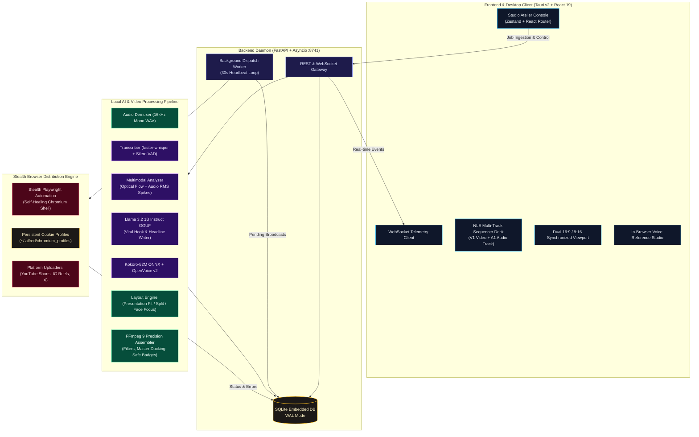
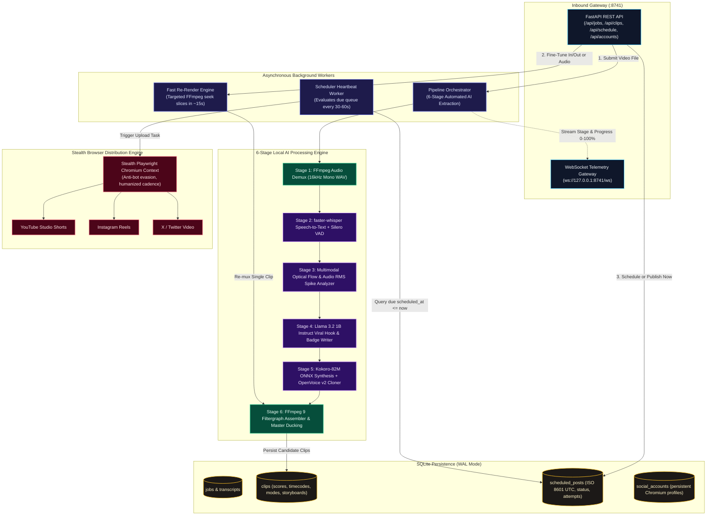
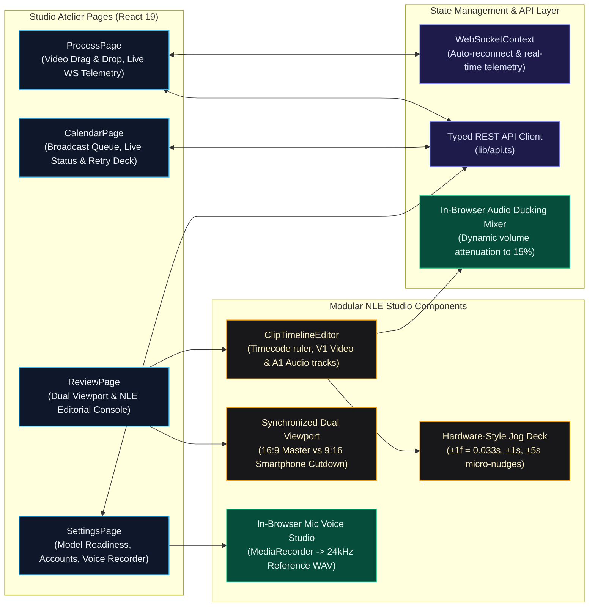
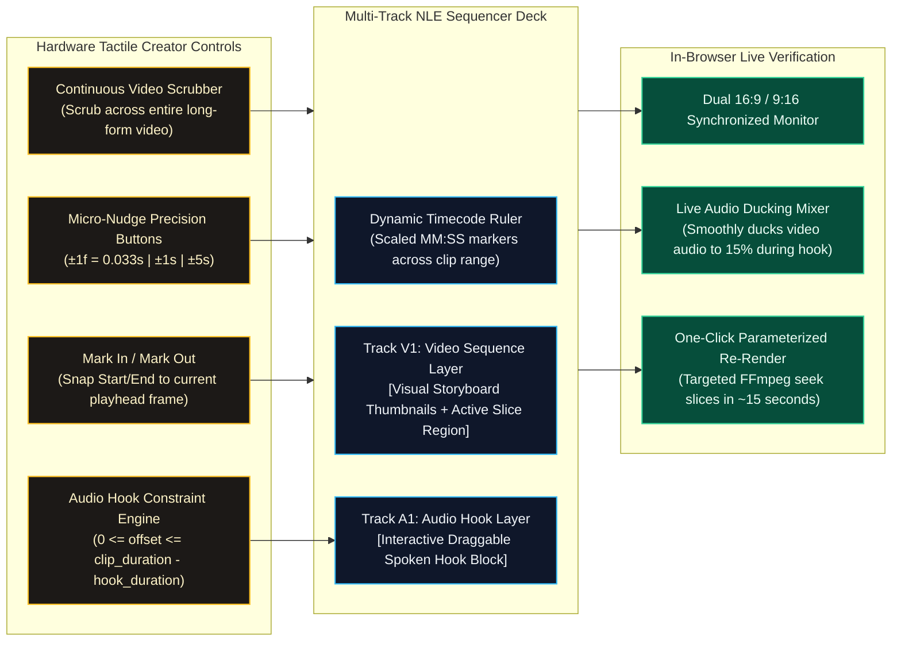
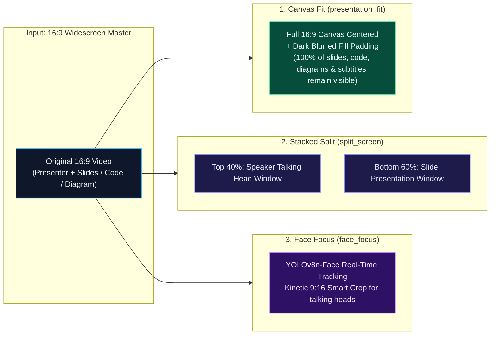
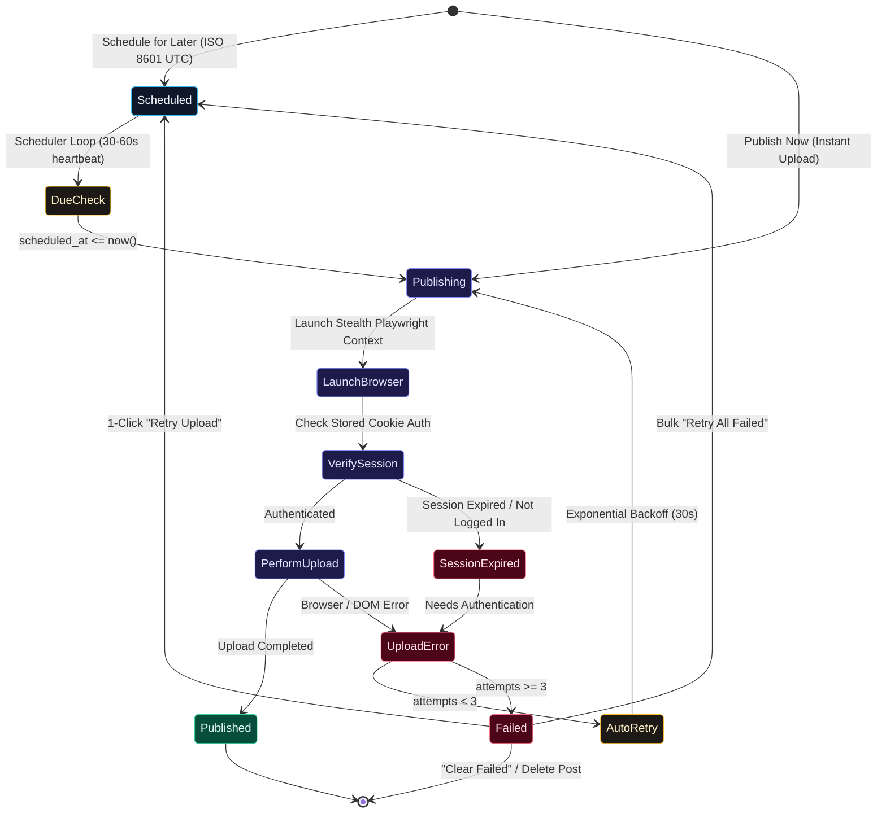
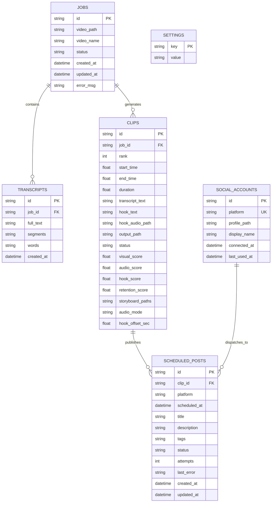

# 🎩 Alfred — Offline-First AI Video Repurposing & Distribution Engine

> **Turn long-form horizontal videos (keynotes, podcasts, technical talks, webinars) into high-retention 9:16 vertical shorts — 100% locally on your own workstation.**  
> Zero cloud fees. Zero API keys. Zero telemetry. Your footage never leaves your machine.

---

## 📑 Table of Contents

- [What is Alfred?](#what-is-alfred)
- [System Architecture](#system-architecture)
  - [High-Level Component Architecture](#high-level-component-architecture)
  - [Backend Daemon & Data Flow](#backend-daemon-data-flow)
  - [Frontend Studio Architecture](#frontend-studio-architecture)
- [The 5 Local AI Models (Architectures & Specs)](#the-5-local-ai-models-architectures-specs)
- [The 6-Stage AI Processing Pipeline](#the-6-stage-ai-processing-pipeline)
  - [Stage 1: High-Speed Audio Demuxing](#stage-1-high-speed-audio-demuxing)
  - [Stage 2: Speech-to-Text with Silero VAD (faster-whisper)](#stage-2-speech-to-text-with-silero-vad-faster-whisper)
  - [Stage 3: Multimodal Hook & Viral Retention Analysis](#stage-3-multimodal-hook-viral-retention-analysis)
  - [Stage 4: Attention Hook & Visual Headline Badge (Llama 3.2 1B)](#stage-4-attention-hook-visual-headline-badge-llama-32-1b)
  - [Stage 5: Voiceover Synthesis & Timbre Cloning (Kokoro-82M + OpenVoice v2)](#stage-5-voiceover-synthesis-timbre-cloning-kokoro-82m-openvoice-v2)
  - [Stage 6: Multi-Framing Layout & Precision FFmpeg Assembly](#stage-6-multi-framing-layout-precision-ffmpeg-assembly)
- [Hardware-Style NLE Multi-Track Sequencer & Live Deck](#hardware-style-nle-multi-track-sequencer-live-deck)
  - [Multi-Track Sequencer Architecture](#multi-track-sequencer-architecture)
  - [Frame-Accurate Micro-Stepping & Whole-Video Scrubbing](#frame-accurate-micro-stepping-whole-video-scrubbing)
  - [In-Browser Live Ducked Audio Preview](#in-browser-live-ducked-audio-preview)
- [Audio Master Routing & Dialogue Isolation](#audio-master-routing-dialogue-isolation)
- [Presentation-Aware 9:16 Framing Engine](#presentation-aware-916-framing-engine)
- [Distribution Engine: Instant Publish & Smart Calendar](#distribution-engine-instant-publish-smart-calendar)
  - [Instant "Publish Now" vs Scheduled Queue](#instant-publish-now-vs-scheduled-queue)
  - [Distribution State Machine & Retry Lifecycle](#distribution-state-machine-retry-lifecycle)
  - [Anti-Detection Stealth Playwright Automation](#anti-detection-stealth-playwright-automation)
  - [Self-Healing Browser Setup & Linux Wayland Support](#self-healing-browser-setup-linux-wayland-support)
- [Hardware Requirements & Performance Profiling](#hardware-requirements-performance-profiling)
- [Database Architecture & WAL Mode](#database-architecture-wal-mode)
  - [Entity-Relationship Diagram](#entity-relationship-diagram)
  - [SQL Schema Definition](#sql-schema-definition)
- [Complete REST & WebSocket API Surface](#complete-rest-websocket-api-surface)
- [Quickstart Guide (Get running in 3 minutes)](#quickstart-guide-get-running-in-3-minutes)
- [Project Directory Tour](#project-directory-tour)
- [Remote Config & Extensibility](#remote-config-extensibility)
- [Frequently Asked Questions & Diagnostics](#frequently-asked-questions-diagnostics)
- [License](#license)

---

## 💡 What is Alfred?

If you have a 1-hour podcast, conference keynote, coding tutorial, or university lecture, turning it into 60-second vertical shorts for **YouTube Shorts, Instagram Reels, and TikTok** takes hours of tedious manual work:

1. You have to re-watch the whole video to find the best 30–60 second moments.
2. You have to crop horizontal 16:9 video into vertical 9:16. Most automatic tools blindly crop the center, which **cuts off 60% of your presentation slides, code editors, and charts**.
3. You have to write punchy title hooks, record voiceovers, and burn in subtitles.
4. You have to manually log into social media and upload each file.

**Alfred automates this entire pipeline locally on your machine:**
- **Finds the best moments** by analyzing where the speaker gets energetic, where people laugh or applaud, and where visual movement happens.
- **Protects your slides and code** by fitting the full presentation in the vertical frame with a clean blurred background, or splitting the screen between the speaker and the slides.
- **Writes & speaks viral opening hooks** using small local AI models so you grab the viewer's attention before they scroll away.
- **Gives you a real editor** with micro-frame nudges, draggable voiceover blocks, and live volume-ducked preview.
- **Publishes with 1 click** using your existing logged-in browser session—no expensive developer APIs or tokens needed.

---

## 🏛️ System Architecture

Alfred combines a reactive **React 19 + TypeScript** frontend with an asynchronous **FastAPI + Python 3.10+** daemon, orchestrated by an embedded **SQLite (WAL mode)** database and a local media assembly engine.

### High-Level Component Architecture



---

### Backend Daemon & Data Flow

The backend daemon coordinates pipeline execution asynchronously without blocking the web event loop:



---

### Frontend Studio Architecture

The frontend is built with React 19, TypeScript, and Tailwind CSS, featuring an architectural layout inspired by Studio Atelier design principles:



---

## 🧠 The 5 Local AI Models (Architectures & Specs)

Alfred doesn't send your video to OpenAI, Google, or any cloud API. Everything runs directly on your CPU or graphics card using 5 specialized local models:

| Model & Library | Architecture & Quantization | Size on Disk / RAM | Runtime & Acceleration | Exact Technical Role |
|---|---|---|---|---|
| **faster-whisper** (`base.en` / `small.en`) | CTranslate2 INT8 quantization with 5-path beam search & Silero Voice Activity Detection (VAD) | ~140 MB – 460 MB disk<br>~1.1 GB RAM | `faster-whisper` (CPU AVX2/AVX-512 SIMD & CUDA) | Strips background music hallucinations, extracts word-level timestamps, and snaps clip boundaries to grammatical pauses. |
| **Llama 3.2 1B Instruct** | GGUF format with `Q4_K_M` 4-bit quantization | 771 MB disk<br>~600 MB RAM | `llama-cpp-python` (Metal / CUDA / CPU BLAS) | Reads the transcript to write a 1–2 sentence verbal hook and a 3-to-7 word uppercase headline badge for the upper safe zone. |
| **Kokoro-82M** | StyleTTS2 architecture running on ONNX Runtime | 311 MB disk<br>~380 MB RAM | `onnxruntime` (CPU / CUDA Execution Providers) | Ultra-fast 24kHz text-to-speech narration with human prosody (RTF ~0.10x, ~0.5s per sentence). |
| **YOLOv8n-Face** | Dynamic 640×640 ONNX model with multithreaded inference | 12.1 MB disk<br>~220 MB RAM | `onnxruntime` (Multithreaded frame inference) | Samples frames at 2 fps to detect speaker faces and applies a 5-frame moving average window to smooth horizontal crop tracking. |
| **OpenVoice v2** | PyTorch Checkpoint & NumPy vector math | 126 MB disk<br>~180 MB RAM | PyTorch / NumPy (CPU & CUDA) | Extracts speaker acoustic embeddings from a 10-second reference mic recording and transfers personal vocal timbre to generated hooks. |

> 💡 **Check status anytime**: In Alfred, go to **Settings → AI Models** to verify that all 5 models are ready.

---

## 🔄 The 6-Stage AI Processing Pipeline

Here is the entire process from raw video to published vertical short:

```mermaid
sequenceDiagram
    autonumber
    actor Creator as Content Creator
    participant Ingest as Ingest Bay (/process)
    participant Server as FastAPI Server (:8741)
    participant Engine as AI Pipeline Engine
    participant Deck as Editorial Console (/review)
    participant Dist as Distribution Engine

    Creator->>Ingest: Upload 16:9 Master Video (MP4 / MOV / MKV)
    Ingest->>Server: POST /api/jobs/upload
    Server-->>Ingest: Job created (ID) + WebSocket connection
    
    rect rgb(20, 26, 38)
        note over Server,Engine: 6-Stage Automated AI Extraction Pipeline
        Server->>Engine: Stage 1: Demux 16kHz Mono Audio (FFmpeg direct stream copy)
        Server->>Engine: Stage 2: Transcribe speech with word-level timestamps (faster-whisper + Silero VAD)
        Server->>Engine: Stage 3: Multimodal optical flow + audio RMS spike analysis
        Server->>Engine: Stage 4: Generate spoken hooks & visual headline badges (Llama 3.2 1B)
        Server->>Engine: Stage 5: Synthesize narration voice / cloned timbre (Kokoro-82M ONNX)
        Server->>Engine: Stage 6: Render initial 9:16 cutdowns (FFmpeg 9 Filtergraph)
    end

    Engine-->>Server: 5 candidate clips saved to SQLite
    Server-->>Ingest: WS Event: job_completed
    Ingest-->>Creator: Transition to Editorial Review Console (/review)

    rect rgb(28, 24, 20)
        note over Creator,Deck: Non-Destructive Editorial Fine-Tuning
        Creator->>Deck: Fine-tune In/Out points using NLE Sequencer & ±1f micro-nudges
        Creator->>Deck: Select Audio Routing (Original / Intro Hook / Custom Voiceover)
        Creator->>Deck: Adjust Voiceover placement slider on timeline
        Creator->>Deck: Click "Apply & Re-render Clip"
        Deck->>Server: POST /api/clips/{id}/rerender
        Server-->>Deck: Re-rendered clip ready in ~15 seconds
    end

    rect rgb(28, 18, 24)
        note over Creator,Dist: Multi-Platform Broadcast Dispatch
        alt Instant Upload
            Creator->>Deck: Click "Publish Now"
            Deck->>Server: POST /api/schedule/publish-now
            Server->>Dist: Trigger immediate background upload via stealth browser
        else Scheduled Post
            Creator->>Deck: Click "Schedule Post"
            Deck->>Server: POST /api/schedule
            Server-->>Deck: Added to Broadcast Calendar (/calendar)
        end
    end
```



### Stage 1: High-Speed Audio Demuxing
- Uses direct stream extraction to demux the master audio into a 16kHz mono WAV file in < 1 second:
  ```bash
  ffmpeg -y -i input.mp4 -vn -acodec pcm_s16le -ar 16000 -ac 1 audio.wav
  ```
- Operates at near-zero CPU overhead with no re-encoding quality degradation.

### Stage 2: Speech-to-Text with Silero VAD (faster-whisper)
- **`faster-whisper` (Base.en / Small.en)**: Employs CTranslate2 INT8 quantization to achieve 4x faster transcription than standard PyTorch Whisper on CPU.
- **5-Path Beam Search**: Accurately recognizes technical terminology, proper nouns, and fast speakers.
- **Silero Voice Activity Detection (VAD)**: Gates transcription to human speech segments, completely preventing music and background silence hallucinations.
- Generates granular word-level timestamps essential for precise clip boundary snapping.

### Stage 3: Multimodal Hook & Viral Retention Analysis
Alfred combines visual, acoustic, and linguistic signals via `pipeline/multimodal_analyzer.py`:
1. **Farneback Dense Optical Flow**: Samples frames at 2 fps using OpenCV to detect visual momentum, camera pans, and screen transitions.
2. **Audio RMS Energy Spikes**: Analyzes dynamic root-mean-square contrast to catch high-arousal acoustic events (laughter, audience applause, enthusiastic vocal swells, dramatic pauses).
3. **Scene-Cut Boundary Anchoring**: Detects camera shot transitions to anchor clip start points naturally.
4. **4-Frame Visual Hook Storyboards**: Automatically captures storyboard frames at `+0.0s`, `+1.0s`, `+2.0s`, and `+3.0s` to verify the opening visual energy.
5. **Calibrated Viral Retention Scores (0–100%)**: Computes a non-linear percentile index where top highlight moments achieve 88%–96% predicted retention, accompanied by clear human-readable narrative rationales.

### Stage 4: Attention Hook & Visual Headline Badge (Llama 3.2 1B)
- **Local Llama 3.2 1B Instruct**: Generates high-converting hook scripts tailored to the clip's transcript:
  - **Spoken Hook**: A natural 1–2 sentence verbal intro designed to tease the core insight.
  - **Visual Headline**: A punchy 3–7 word uppercase headline badge placed in the upper 22% safe-zone.
- Robust heuristic fallback ensures hook generation succeeds even without local LLM weights.

### Stage 5: Voiceover Synthesis & Timbre Cloning (Kokoro-82M + OpenVoice v2)
- **Kokoro-82M ONNX**: 82-million parameter local TTS model with natural phrasing and human prosody at 24kHz.
- **Voice Presets**: High-fidelity voices including `Heart` (warm & engaging), `Bella` (clear & upbeat), `Nicole` (relaxed), `Adam` (confident), and `Michael` (deep & grounded).
- **In-Browser Reference Voice Recorder**: Record 10–15s reference samples with your microphone directly from Settings.
- **OpenVoice v2 Tone Conversion**: Extracts speaker acoustic embeddings and transfers personal timbre to generated hooks offline.

### Stage 6: Multi-Framing Layout & Precision FFmpeg Assembly
- Assembles final vertical reels (1080×1920) using FFmpeg 9 filtergraphs:
  - Scales and centers 16:9 footage with dark blurred background fill (`presentation_fit`), stacked dual viewports (`split_screen`), or face-tracked crop (`face_focus`).
  - Burns high-contrast visual headline badge into the upper safe zone.
  - Mixes audio according to the active audio routing mode with smooth volume curves.

---

## 🎛️ Hardware-Style NLE Multi-Track Sequencer & Live Deck

The Editorial Review Console (`frontend/src/components/ClipTimelineEditor.tsx`) gives creators professional NLE capabilities inside the browser:

### Multi-Track Sequencer Architecture



### Frame-Accurate Micro-Stepping & Whole-Video Scrubbing
- **Frame-Accurate Micro-Stepping**:
  - `±1f`: Single frame step at 30 fps (~0.033 seconds) for sample-accurate cuts.
  - `±1s`: Second jump for quick pacing adjustments.
  - `±5s`: Five-second jump for rapid traversal.
- **Unrestricted Video Scrubber**: Scrub anywhere across the entire video duration—not limited to the current clip slice.
- **Frame Snapping**: "Set Start Here" and "Set End Here" snap clip boundaries directly to the current playhead position.

### In-Browser Live Ducked Audio Preview
- When previewing clips in the browser with `intro_hook` or `custom_voiceover`, Alfred dynamically monitors video playhead position.
- Video audio volume is smoothly ducked (to 15%) while the spoken hook audio plays, and automatically recovered when the hook finishes.

---

## 🎙️ Audio Master Routing & Dialogue Isolation

Alfred eliminates awkward voice collisions between synthetic AI narration and the video's original speaker:

```mermaid
flowchart TD
    classDef natural fill:#064e3b,stroke:#34d399,stroke-width:1.5px,color:#ecfdf5;
    classDef ducked fill:#1e1b4b,stroke:#818cf8,stroke-width:1.5px,color:#e0e7ff;
    classDef custom fill:#1c1917,stroke:#fbbf24,stroke-width:1.5px,color:#fef3c7;

    subgraph Mode1 ["Mode 1: Original Dialogue (original)"]
        direction LR
        Src1["Speaker Dialogue\n(100% Volume)"]:::natural
        Out1["Master Audio: Pure Natural Voice\n(0% synthetic voiceover, 0% ducking, 100% fidelity)"]:::natural
        Src1 --> Out1
    end

    subgraph Mode2 ["Mode 2: Intro Hook at Start (intro_hook)"]
        direction LR
        Hook2["Spoken Hook Narration\n(Plays at t = 0.0s)"]:::ducked
        Duck2["Speaker Dialogue ducked to 15%\nfor hook duration"]:::ducked
        Rec2["Smooth Volume Recovery\nback to 100%"]:::natural
        Hook2 --> Duck2 --> Rec2
    end

    subgraph Mode3 ["Mode 3: Timeline Voiceover (custom_voiceover)"]
        direction LR
        Pre3["Speaker Dialogue at 100%"]:::natural
        Offset3["User Hook Placement\n(hook_offset_sec)"]:::custom
        Duck3["Dialogue dynamically ducked to 15%"]:::ducked
        Post3["Smooth Volume Recovery\nback to 100%"]:::natural
        Pre3 --> Offset3 --> Duck3 --> Post3
    end
```



| Mode | Identifier | Behavior | Ideal Use Case |
|---|---|---|---|
| **Original Sound Only** | `original` | 100% pure source dialogue. Zero AI voiceover, zero audio ducking, zero overlays. | Standalone speeches, funny moments, self-explanatory clips. |
| **Intro Hook at Start** | `intro_hook` | Spoken hook plays at clip start (`t=0.0s`). Source audio ducks to 15% with smooth recovery. | Fast-paced viral shorts needing an immediate verbal grabber. |
| **Timeline Voiceover** | `custom_voiceover` | Spoken hook placed at creator-defined timeline offset (`hook_offset_sec`) with dynamic window ducking. | Dramatic commentary or context explanation over b-roll. |

---

## 📐 Presentation-Aware 9:16 Framing Engine

Traditional vertical tools center-crop 16:9 video, cutting off up to 60% of presentation slides, code editors, and diagrams. Alfred offers three intelligent framing layouts:



1. **Canvas Fit (`presentation_fit`)**: Places the full 16:9 canvas in the center with a subtle dark blurred background fill. **100% of slides, code, equations, and subtitles remain visible.**
2. **Stacked Split (`split_screen`)**: Vertically stacks the speaker's talking head on top and the presentation slide on the bottom.
3. **Face Focus (`face_focus`)**: Tracks the speaker's face with YOLOv8n-Face ONNX to produce a centered 9:16 crop for talking-head-only segments.

---

## 🚀 Distribution Engine: Instant Publish & Smart Calendar

Alfred includes an offline-first social distribution system that bypasses official developer API restrictions, token expirations, and platform developer review processes.

### Instant "Publish Now" vs Scheduled Queue
- **⚡ Instant "Publish Now"**: 1-click button on clip cards (`POST /api/schedule/publish-now`). Automatically marks the clip as approved if needed, records an ISO 8601 UTC timestamp, and immediately triggers an asynchronous background upload task.
- **📅 Schedule for Later**: The schedule modal lets you switch between immediate publication and scheduled publication with custom dates, titles, descriptions, and hashtags.

### Distribution State Machine & Retry Lifecycle



### Anti-Detection Stealth Playwright Automation
- **Persistent Browser Profiles**: Browser sessions and cookies are stored in `~/.alfred/chromium_profiles/{platform}`.
- **Anti-Bot Hardening**:
  - Masks `navigator.webdriver`.
  - Mocks `window.chrome`, browser plugins, languages, and notification permissions.
  - Humanized variable typing cadence (40–120ms per key with natural micro-pauses).
  - Randomized click delays and mouse hover simulations.
- **Interactive Browser Authentication**: `POST /api/accounts/{platform}/connect` opens a visible browser window for manual login, monitors authentication success, and persists cookies automatically.
- **Live Session Health Check**: `GET /api/accounts/{platform}/status` verifies whether saved cookies are still authenticated.

### Self-Healing Browser Setup & Linux Wayland Support
- **Automatic Self-Healing**: `ensure_playwright_browsers()` in `uploaders/stealth.py` automatically checks and installs Chromium browser binaries via `playwright install chromium` if missing.
- **Linux Compatibility Flags**: Launch configurations include `--ozone-platform-hint=auto`, `--ignore-certificate-errors`, and `--no-sandbox` to run seamlessly across Wayland and X11 desktops (KDE Plasma, GNOME, etc.).

---

## ⚡ Hardware Requirements & Performance Profiling

Alfred is designed to run efficiently on standard developer workstations without cloud GPUs:

### System Hardware Specifications

| Component | Minimum Specification | Recommended Specification |
| :--- | :--- | :--- |
| **Processor (CPU)** | 4 Cores (Intel 8th Gen+ / AMD Ryzen 3000+) | 8+ Cores (Apple Silicon M-Series or Intel 12th Gen+ / AMD Ryzen 5000+) |
| **System Memory (RAM)** | 8 GB RAM | 16 GB – 32 GB RAM |
| **Graphics (GPU / VRAM)** | Integrated Graphics | NVIDIA RTX 3060+ (6 GB+ VRAM) or Apple Silicon Unified Memory |
| **Disk Storage** | 10 GB free space on SSD | 25 GB+ free space on NVMe SSD |
| **Operating System** | Linux (Ubuntu 20.04+, Arch, Fedora), macOS 12+, Windows 10/11 (WSL2) | Arch Linux, Ubuntu 22.04 LTS, or macOS Sonoma / Sequoia |

### Per-Component Resource Footprint

| Pipeline Stage | Model Architecture | RAM Usage | VRAM Usage | Latency (10-min Video Input) | Hardware Optimization |
| :--- | :--- | :--- | :--- | :--- | :--- |
| **1. Audio Demux** | FFmpeg Direct Stream | ~50 MB | 0 MB | ~0.8s | Stream copy (`-vn -ac 1 -ar 16000`) |
| **2. Speech-to-Text** | `faster-whisper` (`base`/`small`) | ~1.1 GB | ~850 MB | ~28–45s (CPU) / ~8–12s (CUDA) | CTranslate2 INT8, AVX2 SIMD |
| **3. Highlight Ranker** | Multimodal Flow + RMS | ~150 MB | 0 MB | ~1.2s | NumPy vectorized scoring |
| **4. Hook Generator** | Llama 3.2 1B GGUF | ~600 MB | ~700 MB | ~1.5s | Q4_K_M quantization |
| **5. Kokoro-82M TTS** | StyleTTS2 ONNX | ~380 MB | ~300 MB | ~0.5s per 5s audio | ONNX Runtime CPU/CUDA |
| **6. Voice Cloner** | OpenVoice v2 | ~180 MB | ~100 MB | ~0.3s per slice | Cosine embedding alignment |
| **7. Smart Crop** | YOLOv8n-Face ONNX | ~220 MB | ~150 MB | 60+ FPS | Multithreaded frame inference |
| **8. Video Assembler** | FFmpeg 9 Filtergraph | ~450–750 MB | Optional NVENC | ~15–25s per 45s reel | Multithreaded libx264 |

> **Total Peak Memory**: The entire daemon operates within **1.8 GB to 2.4 GB RAM**, running smoothly alongside your IDE and browser.

---

## 🗄️ Database Architecture & WAL Mode

Alfred uses an embedded SQLite database with Write-Ahead Logging (`PRAGMA journal_mode=WAL`) located at `~/.alfred/db/alfred.db`:

### Entity-Relationship Diagram



### SQL Schema Definition

```sql
-- Core job tracking
CREATE TABLE jobs (
    id          TEXT PRIMARY KEY,
    video_path  TEXT NOT NULL,
    video_name  TEXT NOT NULL,
    status      TEXT NOT NULL DEFAULT 'queued',
    created_at  DATETIME DEFAULT CURRENT_TIMESTAMP,
    updated_at  DATETIME DEFAULT CURRENT_TIMESTAMP,
    error_msg   TEXT
);

-- Whisper transcription output
CREATE TABLE transcripts (
    id          TEXT PRIMARY KEY,
    job_id      TEXT NOT NULL REFERENCES jobs(id) ON DELETE CASCADE,
    full_text   TEXT NOT NULL,
    segments    TEXT NOT NULL,
    words       TEXT NOT NULL,
    created_at  DATETIME DEFAULT CURRENT_TIMESTAMP
);

-- AI-identified clip segments & editorial parameters
CREATE TABLE clips (
    id                    TEXT PRIMARY KEY,
    job_id                TEXT NOT NULL REFERENCES jobs(id) ON DELETE CASCADE,
    rank                  INTEGER NOT NULL,
    start_time            REAL NOT NULL,
    end_time              REAL NOT NULL,
    duration              REAL NOT NULL,
    transcript_text       TEXT NOT NULL,
    hook_text             TEXT,
    hook_audio_path       TEXT,
    output_path           TEXT,
    status                TEXT DEFAULT 'pending',
    rationale             TEXT,
    visual_score          REAL DEFAULT 0.0,
    audio_score           REAL DEFAULT 0.0,
    hook_score            REAL DEFAULT 0.0,
    retention_score       REAL DEFAULT 0.0,
    visual_hook_rationale TEXT,
    storyboard_paths      TEXT,
    audio_mode            TEXT DEFAULT 'original',
    hook_offset_sec       REAL DEFAULT 0.0,
    created_at            DATETIME DEFAULT CURRENT_TIMESTAMP
);

-- Scheduled & published social posts
CREATE TABLE scheduled_posts (
    id              TEXT PRIMARY KEY,
    clip_id         TEXT NOT NULL REFERENCES clips(id) ON DELETE CASCADE,
    platform        TEXT NOT NULL,
    scheduled_at    DATETIME NOT NULL,
    title           TEXT,
    description     TEXT,
    tags            TEXT,
    status          TEXT DEFAULT 'scheduled',
    attempts        INTEGER DEFAULT 0,
    last_error      TEXT,
    created_at      DATETIME DEFAULT CURRENT_TIMESTAMP,
    updated_at      DATETIME DEFAULT CURRENT_TIMESTAMP
);

-- Authenticated browser sessions
CREATE TABLE social_accounts (
    id              TEXT PRIMARY KEY,
    platform        TEXT NOT NULL UNIQUE,
    profile_path    TEXT NOT NULL,
    display_name    TEXT,
    connected_at    DATETIME DEFAULT CURRENT_TIMESTAMP,
    last_used_at    DATETIME
);
```

---

## 📡 Complete REST & WebSocket API Surface

| Method | Endpoint | Request Body | Description |
|---|---|---|---|
| `POST` | `/api/jobs/upload` | Multipart: `file: UploadFile`, `clip_count: int` | Ingest long-form video file and trigger background pipeline |
| `GET` | `/api/jobs` | — | List all historical ingestion jobs |
| `GET` | `/api/jobs/{job_id}` | — | Retrieve job details, telemetry status, and clip list |
| `DELETE`| `/api/jobs/{job_id}` | — | Delete job and remove associated video assets from disk |
| `POST` | `/api/jobs/{job_id}/cancel` | — | Cancel an in-progress pipeline job |
| `GET` | `/api/clips/{clip_id}` | — | Retrieve clip metadata, scores, and paths |
| `GET` | `/api/clips/job/{job_id}`| — | Retrieve all candidate clips for a specific job |
| `PATCH` | `/api/clips/{clip_id}` | `{status, hook_text, start_time, end_time, audio_mode, hook_offset_sec}` | Update clip approval status, hook text, or trim boundaries |
| `POST` | `/api/clips/{clip_id}/rerender` | `{start_time, end_time, framing_mode, audio_mode, hook_offset_sec}` | Re-assemble clip with custom trim boundaries, framing, or audio ducking |
| `POST` | `/api/clips/{clip_id}/synthesize-voice` | `{text, voice_preset, use_voice_clone, sample_name}` | Synthesize Kokoro or cloned voiceover track |
| `POST` | `/api/schedule/publish-now` | `{clip_id, platform, title, description, tags}` | **Immediately upload clip right now** in the background |
| `POST` | `/api/schedule` | `{clip_id, platform, scheduled_at, title, description, tags}` | Schedule a clip for future publication |
| `GET` | `/api/schedule` | Query: `from_date`, `to_date` | Retrieve scheduled calendar posts |
| `PATCH` | `/api/schedule/{post_id}` | `{scheduled_at, title, description, tags, status}` | Reschedule post or update metadata (resets failures) |
| `POST` | `/api/schedule/{post_id}/retry` | — | Reset a failed post to scheduled and trigger immediate upload |
| `POST` | `/api/schedule/retry-all` | — | Reset all failed posts and trigger immediate uploads |
| `DELETE`| `/api/schedule/failed` | — | Bulk delete all failed scheduled posts |
| `DELETE`| `/api/schedule/{post_id}` | — | Cancel and delete a specific scheduled post |
| `GET` | `/api/accounts` | — | List all connected social account profiles |
| `GET` | `/api/accounts/{platform}/status` | — | Check whether saved browser session cookies are still authenticated |
| `POST` | `/api/accounts/{platform}/connect` | Query: `interactive: bool` | Launch visible browser window for manual login and capture session |
| `DELETE`| `/api/accounts/{platform}` | — | Disconnect platform account and delete local profile |
| `GET` | `/api/settings` | — | Retrieve system configuration and preferences |
| `POST` | `/api/settings` | Key-value settings object | Update application configuration |
| `GET` | `/api/settings/models` | — | Retrieve local readiness status of all 5 local AI models |
| `GET` | `/api/settings/voice-samples` | — | List recorded/uploaded voice cloning reference samples |
| `POST` | `/api/settings/voice-sample` | Multipart: `file: UploadFile` | Upload or save in-browser mic recording as reference sample |
| `DELETE`| `/api/settings/voice-samples/{filename}` | — | Delete a stored voice cloning sample |
| `GET` | `/api/media?path=...` | — | Byte-range video and storyboard frame streaming endpoint (`Accept-Ranges: bytes`) |
| `GET` | `/api/health` | — | System health check, database status, and uptime |
| `WS` | `/ws` | — | Real-time bi-directional pipeline telemetry channel |

---

## 🚀 Quickstart Guide (Get running in 3 minutes)

### Step 1: Install System Tools
Make sure `ffmpeg` is installed on your computer:
```bash
# Ubuntu / Debian
sudo apt update && sudo apt install -y ffmpeg

# Arch Linux
sudo pacman -S ffmpeg

# macOS (Homebrew)
brew install ffmpeg
```

Make sure **uv** (the fast Python manager) is installed:
```bash
curl -LsSf https://astral.sh/uv/install.sh | sh
```

### Step 2: Clone the Project
```bash
git clone https://github.com/DivyamJoshi2005/Alfred.git
cd Alfred
```

### Step 3: Start the Backend Server
```bash
cd backend
uv sync
uv run python main.py
```
*The server will start at `http://127.0.0.1:8741` and automatically set up its database.*

### Step 4: Open the Studio Interface
Open your web browser and visit:  
👉 **`http://127.0.0.1:8741`**

*(Optional)* If you want to develop or edit the frontend code live with hot-reloading:
```bash
cd frontend
npm install
npm run dev
```

---

## 📁 Project Directory Tour

Here is what each folder in Alfred does:

```text
Alfred/
├── backend/                  # The Python server that runs AI & renders video
│   ├── main.py               # Starts the server and serves the web interface
│   ├── config.py             # System settings, model paths, and default ports
│   ├── database.py           # SQLite database setup (jobs, clips, schedule)
│   ├── pipeline/             # The 6 core processing steps
│   │   ├── transcriber.py    # Whisper speech-to-text
│   │   ├── multimodal_analyzer.py # Finds the best highlight moments
│   │   ├── hook_generator.py # Llama 3.2 hook script writer
│   │   ├── tts.py            # Kokoro voice generator
│   │   ├── voice_cloner.py   # OpenVoice voice clone matcher
│   │   ├── smart_crop.py     # YOLO face detection
│   │   └── assembler.py      # FFmpeg video slicer and crop renderer
│   ├── routers/              # API web routes (jobs, clips, schedule, accounts)
│   ├── scheduler/            # Background timer that triggers scheduled uploads
│   └── uploaders/            # Playwright browser scripts for YouTube, IG, and X
├── frontend/                 # The React 19 web application
│   ├── src/
│   │   ├── pages/            # The 4 main screens (Process, Review, Calendar, Settings)
│   │   ├── components/       # UI parts (Timeline Editor, Modals, Sidebar)
│   │   ├── lib/              # API helpers, formatters, and TypeScript types
│   │   └── App.tsx           # App routing and layout
├── models/                   # Folder where AI model weights live locally
└── dist/                     # The compiled production frontend
```

---

## 🌐 Remote Config & Extensibility

Alfred is built first and foremost as an **offline-first local workstation engine** with SQLite persistence and zero cloud dependencies.

For teams wrapping Alfred into distributed mobile apps (iOS / Android shells) or multi-machine studio setups that need cloud-based feature flags, dynamic parameter tuning, or rollouts:
- **Firebase Remote Config** can be paired with client wrappers to manage server-side parameters without app recompilation.
- Export and inspect configuration templates via the Firebase CLI:
  ```bash
  npx -y firebase-tools@latest remoteconfig:get -o remote_config.json
  ```
- Deploy updated templates with:
  ```bash
  npx -y firebase-tools@latest deploy --only remoteconfig
  ```

---

## ❓ Frequently Asked Questions & Diagnostics

### 1. Why does my upload fail with "Session expired or not logged in"?
Alfred uploads using your real browser session. If you haven't logged in yet:
1. Go to **Settings → Connected Accounts**.
2. Click **"Log In via Browser"** next to YouTube, Instagram, or X.
3. A real browser window will appear. Log into your account and wait until your creator dashboard loads.
4. Close the browser window.
5. Go back to the **Calendar** page and click **"Retry Upload"**.

### 2. Can I use Alfred completely without an internet connection?
**Yes!** Once the AI models are downloaded to your `models/` folder, the entire transcription, highlight scoring, voiceover generation, and 9:16 rendering pipeline runs 100% offline. You can edit videos on an airplane. Internet is only required when uploading to YouTube/Instagram/X.

### 3. What if it says "Port 8741 already in use"?
Another copy of the server is running in the background. Stop it with:
```bash
fuser -k 8741/tcp
```
Then start the server again with `uv run python main.py`.

### 4. Will my slides or code get cut off in vertical video?
**No!** Simply make sure the framing mode is set to **Canvas Fit** (which is the default). Canvas Fit places the full 16:9 widescreen presentation in the center and fills the empty top and bottom with a soft blurred background. 100% of your text, diagrams, and code remain fully legible.

---

## 📄 License

This project is open-source and released under the **MIT License**. See the [LICENSE](LICENSE) file for details.

---

<p align="center">
  <b>Alfred</b> — Built with care for video creators, educators, and technical speakers.
</p>
