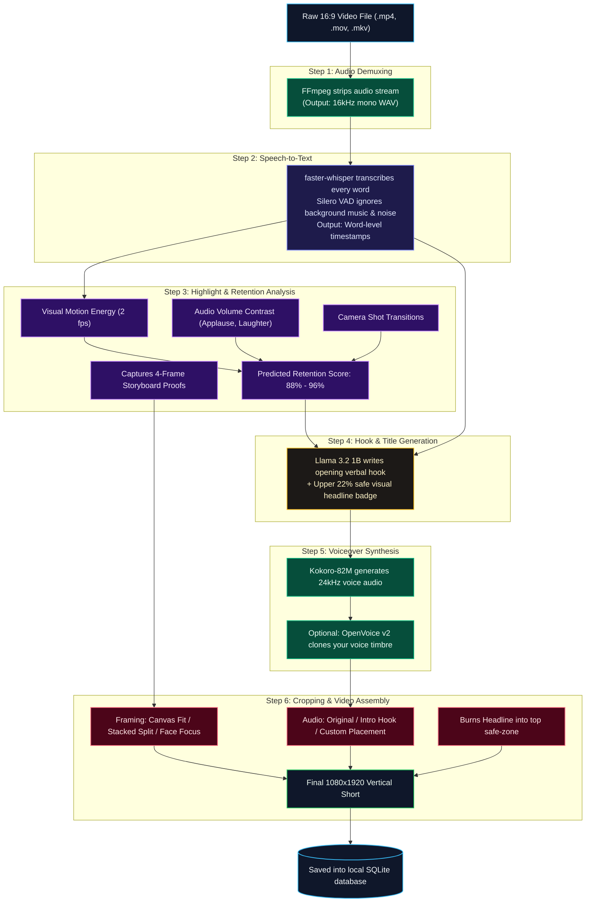
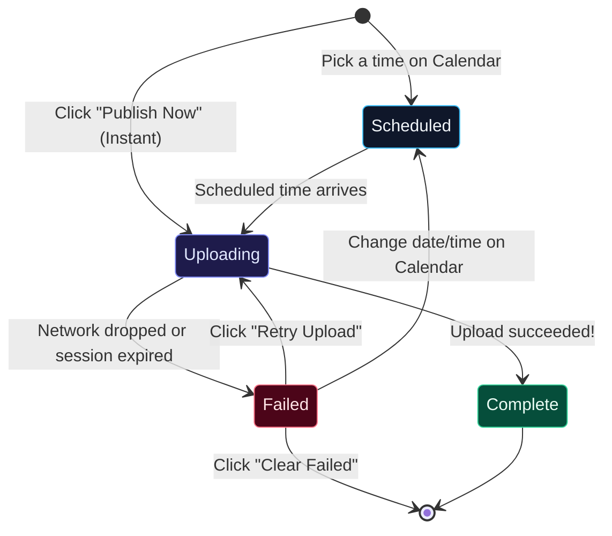

# ⚙️ Alfred Backend & Local AI Studio

> **The local Python server, AI engine, and media renderer powering Alfred.**  
> Everything runs on your machine: speech-to-text, viral highlight detection, voice generation, and vertical video cropping.

---

## 📑 Table of Contents

- [What Does the Backend Do?](#what-does-the-backend-do)
- [How the AI Pipeline Works Step-by-Step](#how-the-ai-pipeline-works-step-by-step)
- [The 5 Local AI Models](#the-5-local-ai-models)
- [Tour of the Pipeline Code](#tour-of-the-pipeline-code)
  - [1. Audio Demuxing & Transcription (`transcriber.py`)](#1-audio-demuxing-transcription-transcriberpy)
  - [2. Finding Highlights (`multimodal_analyzer.py`)](#2-finding-highlights-multimodalanalyzerpy)
  - [3. Writing Hooks & Headlines (`hook_generator.py`)](#3-writing-hooks-headlines-hookgeneratorpy)
  - [4. Generating Voiceovers (`tts.py` & `voice_cloner.py`)](#4-generating-voiceovers-ttspy-voiceclonerpy)
  - [5. Face Tracking & Smart Cropping (`smart_crop.py`)](#5-face-tracking-smart-cropping-smartcroppy)
  - [6. Precision FFmpeg Video Slicer (`assembler.py`)](#6-precision-ffmpeg-video-slicer-assemblerpy)
  - [7. Pipeline Orchestration (`orchestrator.py`)](#7-pipeline-orchestration-orchestratorpy)
- [How Automated Publishing Works](#how-automated-publishing-works)
- [Database Schema (SQLite in WAL Mode)](#database-schema-sqlite-in-wal-mode)
- [API Reference](#api-reference)
- [Quick Local Setup with uv](#quick-local-setup-with-uv)
- [Troubleshooting & Common Fixes](#troubleshooting-common-fixes)

---

## 💡 What Does the Backend Do?

The backend is a fast Python service built with **FastAPI** and **asyncio**. When you drop a video into Alfred, the backend coordinates all the background work:

1. **Strips the audio** from the video file into a clean 16kHz WAV format.
2. **Listens and transcribes** every word with exact timestamps using local Whisper.
3. **Finds the best 30–60 second clips** by looking for spikes in audio volume (laughter, applause, energy) and visual movement.
4. **Writes a 3-second hook** using a small local LLM (Llama 3.2 1B).
5. **Speaks the hook** using local voice synthesis (Kokoro-82M), or matches your own voice clone.
6. **Crops and renders** the vertical 9:16 video using FFmpeg without cutting off slides or presentation text.
7. **Uploads to social media** via an automated browser (Playwright) using your logged-in cookies.

All progress is streamed live to the frontend in real time via WebSockets (`ws://127.0.0.1:8741/ws`).

---

## 🔄 How the AI Pipeline Works Step-by-Step



---

## 🧠 The 5 Local AI Models

All models live locally in your `models/` directory or HuggingFace cache:

| Model | What it does | Size | Runtime |
|---|---|---|---|
| **Whisper (Base / Small)** | Transcribes spoken audio into text with word timestamps and voice-activity filtering. | ~140 – 460 MB | `faster-whisper` (CPU AVX2 / CUDA) |
| **Llama 3.2 1B Instruct** | Reads transcripts to find the best angle and writes opening hooks and headline badges. | 771 MB | `llama-cpp-python` (GGUF Q4_K_M) |
| **Kokoro-82M** | Fast local text-to-speech generating natural-sounding narration in 0.5 seconds. | 311 MB | `onnxruntime` (StyleTTS2 architecture) |
| **YOLOv8n-Face** | Real-time face tracking for talking-head vertical auto-cropping. | 12.1 MB | `onnxruntime` (Dynamic 640x640) |
| **OpenVoice v2** | Extracts acoustic characteristics from a 10-second mic recording to clone your voice. | 126 MB | PyTorch & NumPy |

---

## 🛠️ Tour of the Pipeline Code

### 1. Audio Demuxing & Transcription (`transcriber.py`)
- Strips audio into a 16kHz mono WAV in less than a second using direct stream copying:
  ```bash
  ffmpeg -y -i input.mp4 -vn -acodec pcm_s16le -ar 16000 -ac 1 audio.wav
  ```
- Feeds the WAV into `faster-whisper`.
- Uses **Silero Voice Activity Detection (VAD)** to ignore silence, coughs, and background music, preventing the AI from hallucinating words during quiet moments.

### 2. Finding Highlights (`multimodal_analyzer.py`)
Instead of just counting keywords, Alfred scores video clips across three real-world signals:
- **Audio volume spikes**: Catches audience laughter, applause, gasps, and passionate speaker delivery.
- **Visual motion**: Uses optical flow (2 frames per second) to find camera pans, demonstrative hand gestures, and scene changes.
- **Shot boundaries**: Anchors clip starting points to natural camera cuts.
- Generates 4 storyboard proof frames (`+0s`, `+1s`, `+2s`, `+3s`) so you can visually verify the hook before rendering.

### 3. Writing Hooks & Headlines (`hook_generator.py`)
- Uses **Llama 3.2 1B Instruct** to write:
  - **Spoken Hook**: A natural 1–2 sentence sentence to hook the listener.
  - **Visual Headline**: A 3-to-7 word uppercase title badge placed in the upper 22% safe-zone (so TikTok/Reels buttons don't block it).
- Includes a rule-based fallback so it still works if LLM weights are not downloaded.

### 4. Generating Voiceovers (`tts.py` & `voice_cloner.py`)
- Runs **Kokoro-82M** to create crisp 24kHz audio in half a second.
- Voices include `Heart` (warm female), `Adam` (confident male), `Bella` (clear & upbeat), and `Michael` (deep studio).
- If you recorded your voice in Settings, `voice_cloner.py` takes the Kokoro audio and transfers your personal vocal tone onto it.

### 5. Face Tracking & Smart Cropping (`smart_crop.py`)
- Detects the presenter's face using **YOLOv8n-Face ONNX**.
- Uses a 5-frame moving average so the camera crop glides smoothly without sudden, jerky jumps.

### 6. Precision FFmpeg Video Slicer (`assembler.py`)
Renders broadcast-ready 1080×1920 MP4 files:
- **Framing Modes**:
  - `presentation_fit`: Keeps 100% of widescreen slides centered with a soft blurred background.
  - `split_screen`: Speaker head on top, slides on bottom.
  - `face_focus`: Centered 9:16 crop following the speaker.
- **Audio Modes**:
  - `original`: 100% natural speaker voice, zero AI voiceover.
  - `intro_hook`: AI hook plays at `0.0s` while the video volume dips to 15%, then recovers.
  - `custom_voiceover`: Voiceover plays at your chosen timeline second.
- **Fast Re-Rendering**: When you tweak trim points or move the voiceover slider in the review UI, `assembler.py` re-cuts only that single clip in ~15 seconds using targeted FFmpeg seek filters (`-ss`, `-to`).

### 7. Pipeline Orchestration (`orchestrator.py`)
Runs the 6 stages in an asynchronous background loop and broadcasts live progress percentages (0% → 100%) to the frontend via WebSockets.

---

## 🚀 How Automated Publishing Works

Alfred doesn't require complex API keys. Instead, it uses **Playwright** to open a secure local browser window with your existing login sessions stored in `~/.alfred/chromium_profiles/`.



- **Human-like typing**: Types titles and tags with natural key delays (40–120ms) to prevent bot detection.
- **Self-Healing browser setup**: `ensure_playwright_browsers()` automatically downloads missing Chromium binaries on demand.
- **Linux Wayland/X11 compatibility**: Includes flags (`--ozone-platform-hint=auto`, `--no-sandbox`) so it runs smoothly on KDE Plasma, GNOME, and Linux desktops.

---

## 🗄️ Database Schema (SQLite in WAL Mode)

Alfred stores all metadata in a local file at `~/.alfred/db/alfred.db` using SQLite with Write-Ahead Logging (`WAL` mode) for fast concurrent reads and writes:

- **`jobs`**: Tracks video files, overall status (`queued`, `transcribing`, `rendering`, `completed`), and error messages.
- **`transcripts`**: Stores full transcript text, segments, and word-level timestamps from Whisper.
- **`clips`**: Stores extracted clips, start/end timestamps, retention scores, storyboard image paths, framing mode, audio mode, and voiceover offset.
- **`scheduled_posts`**: Social upload queue with platform targets (YouTube, Instagram, X), scheduled dates in ISO 8601 UTC with `Z`, status (`scheduled`, `uploading`, `uploaded`, `failed`), retry counters, and error logs.
- **`social_accounts`**: Stores local Chromium profile directories and connected account names.
- **`settings`**: Key-value settings store for user preferences.

---

## 📡 API Reference

| Method | Route | Description |
|---|---|---|
| `POST` | `/api/jobs/upload` | Upload video file and start pipeline |
| `GET` | `/api/jobs` | List all historical video jobs |
| `GET` | `/api/jobs/{id}` | Get job status, progress, and clip list |
| `GET` | `/api/clips/job/{job_id}` | Get clips for a job with scores and storyboard paths |
| `POST` | `/api/clips/{id}/rerender` | Re-render clip with new trim boundaries, framing, or audio settings |
| `POST` | `/api/clips/{id}/synthesize-voice` | Generate hook voiceover using Kokoro or cloned voice |
| `POST` | `/api/schedule/publish-now` | **Immediately upload clip right now** in the background |
| `POST` | `/api/schedule` | Schedule a clip for future upload |
| `POST` | `/api/schedule/{id}/retry` | Reset failed post and retry upload immediately |
| `POST` | `/api/schedule/retry-all` | Retry all failed uploads |
| `DELETE`| `/api/schedule/failed` | Clear all failed records from queue |
| `POST` | `/api/accounts/{platform}/connect`| Open browser window for manual login |
| `GET` | `/api/settings/models` | Check readiness of the 5 local AI models |
| `GET` | `/api/media?path=...` | Stream local video or storyboard image to the frontend |
| `WS` | `/ws` | WebSocket channel streaming live progress and logs |

---

## 🚀 Quick Local Setup with uv

```bash
cd backend

# 1. Install dependencies in a clean virtual environment
uv sync

# 2. Run the server
uv run python main.py
```

- **Web Interface**: [http://127.0.0.1:8741](http://127.0.0.1:8741)
- **Interactive API Documentation (Swagger)**: [http://127.0.0.1:8741/docs](http://127.0.0.1:8741/docs)

---

## ❓ Troubleshooting & Common Fixes

- **Browser Missing**: If Playwright says Chromium is missing, run `.venv/bin/playwright install chromium`. Alfred will also attempt to auto-install it automatically.
- **Port 8741 in Use**: If another server process is running, stop it with `fuser -k 8741/tcp`.
- **FFmpeg 9 Drawtext Errors**: Alfred automatically cleans up `%`, quotes, colons, and backslashes before running FFmpeg filtergraphs so text overlays render cleanly.
