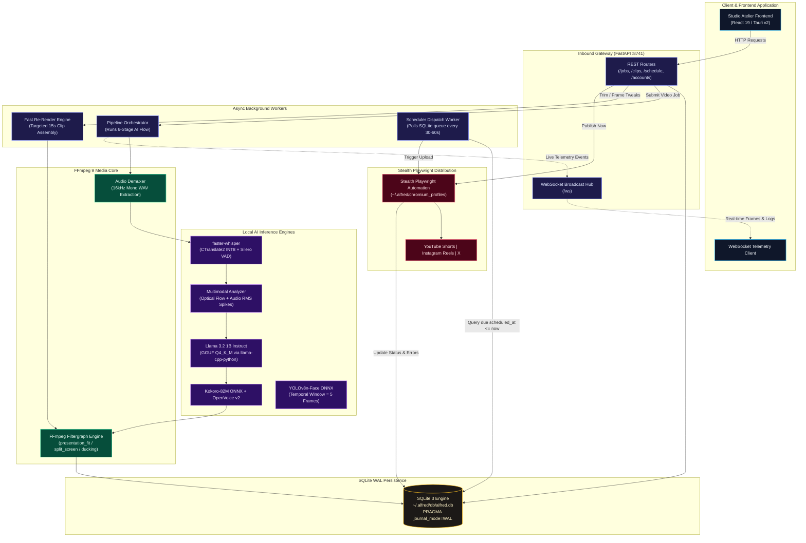
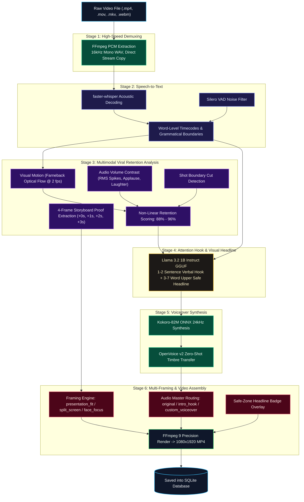
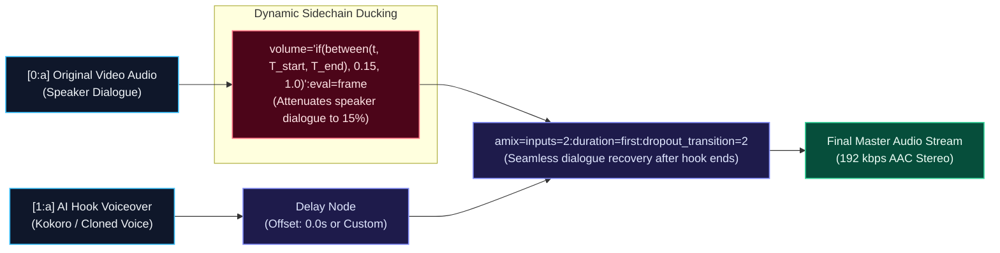
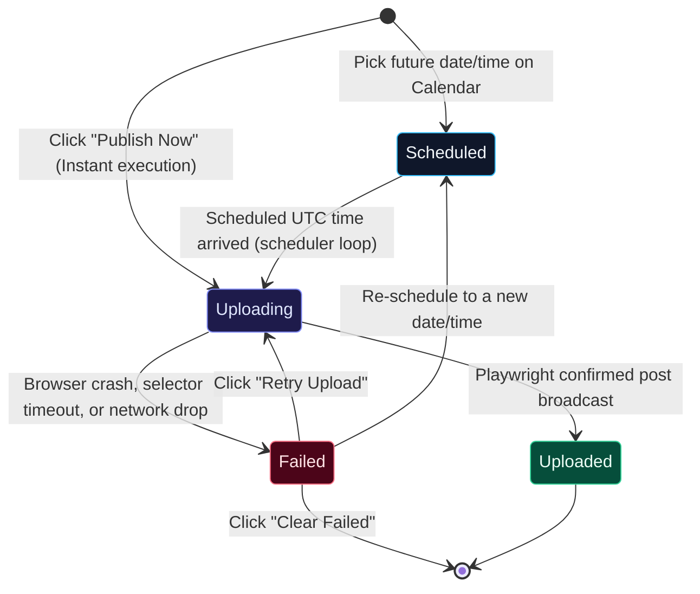
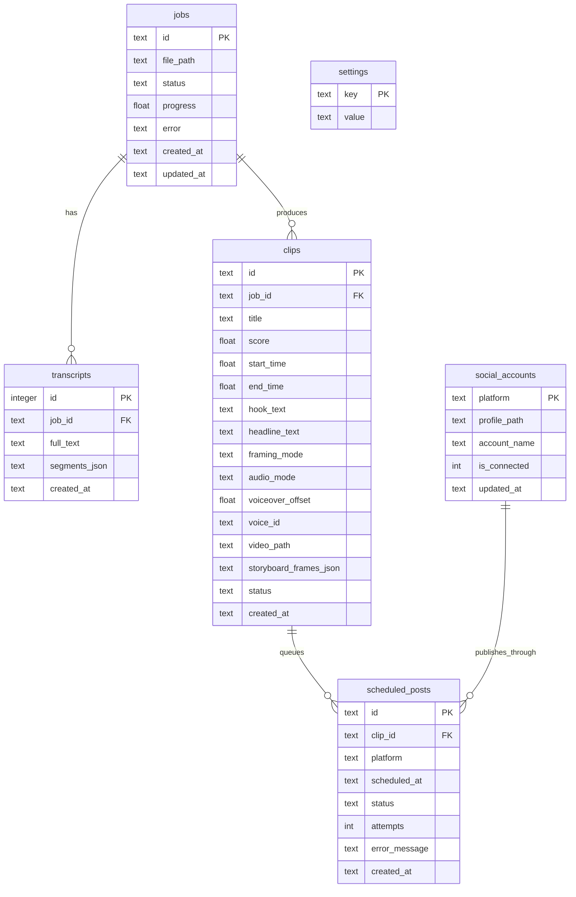
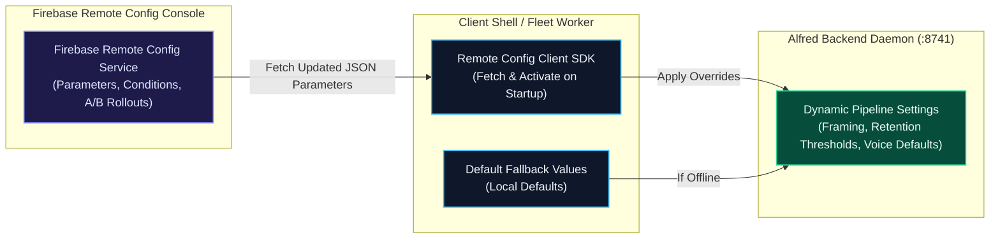

# ⚙️ Alfred Backend — Local AI Video Processing Engine & Media Server

> **A high-performance, asynchronous Python backend that turns long-form horizontal video into high-retention 9:16 vertical shorts — running 100% offline on your local machine.**  
> Built with FastAPI, SQLite (WAL mode), CTranslate2, GGUF/llama.cpp, ONNX Runtime, FFmpeg 9, and stealth Playwright browser automation.

---

## 📑 Table of Contents

- [What Does the Backend Do?](#what-does-the-backend-do)
- [Backend Architecture & Concurrency Model](#backend-architecture-concurrency-model)
  - [Architecture Overview](#architecture-overview)
  - [Real-Time WebSocket Telemetry Protocol](#real-time-websocket-telemetry-protocol)
- [The 5 Local AI Models (Architectures & Specs)](#the-5-local-ai-models-architectures-specs)
  - [Model Specifications Table](#model-specifications-table)
  - [1. faster-whisper (Speech-to-Text with Silero VAD)](#1-faster-whisper-speech-to-text-with-silero-vad)
  - [2. Llama 3.2 1B Instruct (Attention Hooks & Visual Headline Badges)](#2-llama-32-1b-instruct-attention-hooks-visual-headline-badges)
  - [3. Kokoro-82M (Ultra-Fast 24kHz Voice Synthesis)](#3-kokoro-82m-ultra-fast-24khz-voice-synthesis)
  - [4. YOLOv8n-Face (Dynamic Presenter Face Tracking)](#4-yolov8n-face-dynamic-presenter-face-tracking)
  - [5. OpenVoice v2 (Zero-Shot Speaker Timbre Cloning)](#5-openvoice-v2-zero-shot-speaker-timbre-cloning)
- [The 6-Stage AI Processing Pipeline](#the-6-stage-ai-processing-pipeline)
  - [Pipeline Flowchart](#pipeline-flowchart)
  - [Stage 1: High-Speed Audio Demuxing (`transcriber.py`)](#stage-1-high-speed-audio-demuxing-transcriberpy)
  - [Stage 2: Speech-to-Text & Word Alignment (`transcriber.py`)](#stage-2-speech-to-text-word-alignment-transcriberpy)
  - [Stage 3: Multimodal Viral Retention Analysis (`multimodal_analyzer.py`)](#stage-3-multimodal-viral-retention-analysis-multimodal_analyzerpy)
  - [Stage 4: Attention Hook & Headline Generation (`hook_generator.py`)](#stage-4-attention-hook-headline-generation-hook_generatorpy)
  - [Stage 5: Voiceover Synthesis & Cloning (`tts.py` & `voice_cloner.py`)](#stage-5-voiceover-synthesis-cloning-ttspy-voice_clonerpy)
  - [Stage 6: Multi-Framing Layout & Precision FFmpeg Assembly (`assembler.py`)](#stage-6-multi-framing-layout-precision-ffmpeg-assembly-assemblerpy)
- [Audio Master Routing & Dynamic Dialogue Ducking](#audio-master-routing-dynamic-dialogue-ducking)
- [Presentation-Aware 9:16 Framing Engine](#presentation-aware-916-framing-engine)
- [Stealth Social Distribution Engine](#stealth-social-distribution-engine)
  - [Distribution State Machine](#distribution-state-machine)
  - [Instant "Publish Now" vs Scheduled Dispatch Worker](#instant-publish-now-vs-scheduled-dispatch-worker)
  - [Anti-Detection Browser Automation](#anti-detection-browser-automation)
  - [Self-Healing Browser Setup & Linux Wayland Support](#self-healing-browser-setup-linux-wayland-support)
- [Database Schema (SQLite with WAL Mode)](#database-schema-sqlite-with-wal-mode)
  - [Entity-Relationship Diagram](#entity-relationship-diagram)
  - [Table Definitions & Concurrency](#table-definitions-concurrency)
- [Complete REST & WebSocket API Surface](#complete-rest-websocket-api-surface)
- [Remote Config & Extensibility](#remote-config-extensibility)
- [Installation & Local Setup](#installation-local-setup)
- [Troubleshooting & Common Edge Cases](#troubleshooting-common-edge-cases)

---

## 💡 What Does the Backend Do?

When you drop a horizontal 16:9 video file into Alfred or paste a YouTube video link, the backend coordinates all compute-intensive background work on your local machine:

0. **Ingests video effortlessly**: Accepts local video uploads or downloads any public YouTube video via built-in `yt-dlp` with real-time download percentage telemetry.
1. **Extracts high-fidelity audio** into a clean 16kHz mono WAV format without re-encoding video.
2. **Transcribes speech** into word-level timestamps using `faster-whisper` and filters out ambient noise with `Silero VAD`.
3. **Discovers high-retention highlights** (30–60s) by combining visual motion energy (Farneback dense optical flow) and acoustic volume spikes (laughter, applause, energetic delivery).
4. **Writes viral spoken hooks and headline badges** using an on-device `Llama 3.2 1B Instruct` GGUF model.
5. **Synthesizes voiceovers in 0.5s** using `Kokoro-82M ONNX` (StyleTTS2 architecture) or clones your own voice with `OpenVoice v2`.
6. **Assembles broadcast-quality 1080×1920 MP4s** with FFmpeg 9, protecting presentation slides via blurred letterboxing or stacked split-screen.
7. **Publishes directly to social platforms** (YouTube Shorts, Instagram Reels, X) via stealth Playwright browser contexts using your existing session cookies.

---

## 🏛️ Backend Architecture & Concurrency Model

The backend runs an asynchronous **FastAPI** server on port `8741`. Because AI model inference and video rendering are CPU/GPU-heavy, Alfred prevents event-loop blocking by delegating intensive tasks to dedicated thread pools (`asyncio.to_thread`) and subprocesses (`asyncio.create_subprocess_exec`).

### Architecture Overview



---

### Real-Time WebSocket Telemetry Protocol

The frontend connects to `ws://127.0.0.1:8741/ws` upon initialization. As background tasks execute, the backend streams structured telemetry packets:

```json
{
  "type": "progress",
  "job_id": "job_94a7e2b1",
  "stage": "transcribing",
  "progress": 35.0,
  "message": "Transcribing speech: 245 words detected with word-level timestamps"
}
```

```json
{
  "type": "clip_ready",
  "job_id": "job_94a7e2b1",
  "clip_id": "clip_3f81c9a0",
  "title": "HOW TO SCALE PYTHON TO 100K REQ/SEC",
  "score": 94.2,
  "start_time": 142.5,
  "end_time": 187.2,
  "storyboard_frames": [
    "/api/media?path=~/.alfred/frames/clip_3f81c9a0_0.jpg",
    "/api/media?path=~/.alfred/frames/clip_3f81c9a0_1.jpg",
    "/api/media?path=~/.alfred/frames/clip_3f81c9a0_2.jpg",
    "/api/media?path=~/.alfred/frames/clip_3f81c9a0_3.jpg"
  ]
}
```

---

## 🧠 The 5 Local AI Models (Architectures & Specs)

Alfred is engineered around on-device inference. No video frames, audio samples, or transcripts are transmitted across external networks.

### Model Specifications Table

| Model | Architecture & Precision | Disk Size / RAM | Runtime Engine | Execution Provider | Primary Responsibility |
|---|---|---|---|---|---|
| **faster-whisper** | CTranslate2 INT8 (`base.en` / `small.en`) | ~140–460 MB disk<br>~1.1 GB RAM | CTranslate2 | CPU (AVX2/AVX-512) or CUDA | High-speed speech transcription, word-level timestamping, and Silero VAD noise gating. |
| **Llama 3.2 1B Instruct** | GGUF `Q4_K_M` 4-bit quantization | 771 MB disk<br>~600 MB RAM | `llama-cpp-python` | Metal / CUDA / CPU BLAS | Natural language reasoning, verbal hook extraction, and uppercase safe-zone headline authoring. |
| **Kokoro-82M** | StyleTTS2 on ONNX Runtime | 311 MB disk<br>~380 MB RAM | `onnxruntime` | CPU / CUDA | Rapid 24kHz text-to-speech synthesis (~0.5s generation time, 0.10x Real-Time Factor). |
| **YOLOv8n-Face** | Dynamic 640×640 single-stage ONNX | 12.1 MB disk<br>~220 MB RAM | `onnxruntime` | CPU multithreaded | Frame-by-frame presenter face bounding box detection with 5-frame temporal smoothing. |
| **OpenVoice v2** | PyTorch Checkpoint + NumPy vector math | 126 MB disk<br>~180 MB RAM | PyTorch / NumPy | CPU or CUDA | Zero-shot acoustic tone and timbre transfer using a 10-second reference mic recording. |

---

### 1. faster-whisper (Speech-to-Text with Silero VAD)
- **Module**: `backend/pipeline/transcriber.py`
- **Engine**: CTranslate2 engine executing INT8 quantized Transformer weights.
- **VAD Pre-Filtering**: Leverages **Silero Voice Activity Detection** to segment speech from non-speech before feeding audio to the acoustic encoder. This eliminates repetitive hallucinations during long pauses or background music sections.
- **Word-Level Alignment**: Outputs exact begin and end timecodes for every word, enabling sub-second snapping of clip start and end points to natural grammatical pauses.

### 2. Llama 3.2 1B Instruct (Attention Hooks & Visual Headline Badges)
- **Module**: `backend/pipeline/hook_generator.py`
- **Engine**: `llama-cpp-python` executing `Llama-3.2-1B-Instruct-Q4_K_M.gguf`.
- **Inference Configuration**: Temperature `0.7`, top-p `0.9`, max output tokens `150`.
- **Dual Output Contract**:
  - **Spoken Attention Hook**: A high-impact 1–2 sentence statement designed to grab the listener in the first 3 seconds.
  - **Visual Headline Badge**: A 3-to-7 word uppercase headline overlay placed within the upper 22% safe-zone to avoid platform UI collisions.
- **Deterministic Fallback**: If LLM weights are not downloaded, the module falls back to high-scoring transcript sentence extraction with zero crash risk.

### 3. Kokoro-82M (Ultra-Fast 24kHz Voice Synthesis)
- **Module**: `backend/pipeline/tts.py`
- **Engine**: ONNX Runtime running the StyleTTS2 architecture.
- **Sample Rate**: Crisp 24kHz broadcast audio output.
- **Voice Library**: Supports built-in styles including `af_heart` (warm female), `am_adam` (assertive male), `af_bella` (bright/upbeat), and `am_michael` (studio depth).
- **Performance**: Yields an RTF (Real-Time Factor) of ~0.10x, generating a 3-second hook in approximately 300–500 milliseconds.

### 4. YOLOv8n-Face (Dynamic Presenter Face Tracking)
- **Module**: `backend/pipeline/smart_crop.py`
- **Engine**: Dynamic 640×640 single-stage face detection ONNX model.
- **Sampling Frequency**: Subsamples video at 2 fps to balance accuracy with CPU efficiency.
- **Temporal Box Smoothing**: Applies a 5-frame moving average window ($window = 5$) to bounding box coordinates:
  $$\bar{x}_t = \frac{1}{K}\sum_{i=0}^{K-1} x_{t-i}$$
  This prevents camera crop jitter while smoothly tracking presenter movement across a stage.

### 5. OpenVoice v2 (Zero-Shot Speaker Timbre Cloning)
- **Module**: `backend/pipeline/voice_cloner.py`
- **Engine**: PyTorch acoustic embedding extraction and vector tone-color mapping.
- **Workflow**: Reads a 10-second reference WAV captured via the frontend mic studio, extracts the speaker's vocal timbre signature, and maps it onto Kokoro's synthesized speech base.

---

## 🔄 The 6-Stage AI Processing Pipeline

The backend processes long-form horizontal video through 6 specialized, sequential stages managed by `backend/pipeline/orchestrator.py`:

### Pipeline Flowchart



---

### Stage 1: High-Speed Audio Demuxing (`transcriber.py`)
Directly extracts audio from the source video into uncompressed 16-bit 16kHz mono PCM WAV in under 1 second without decoding the video stream:
```bash
ffmpeg -y -i input.mp4 -vn -acodec pcm_s16le -ar 16000 -ac 1 audio.wav
```

### Stage 2: Speech-to-Text & Word Alignment (`transcriber.py`)
- Feeds the extracted WAV to `faster-whisper`.
- Employs **Silero Voice Activity Detection** with a threshold of 0.5 to suppress silence and ambient room noise.
- Generates precise word-level timecodes and serializes transcripts into the SQLite `transcripts` table.

### Stage 3: Multimodal Viral Retention Analysis (`multimodal_analyzer.py`)
Scores candidate 30–60 second clips by fusing two complementary sensory signals:
1. **Visual Motion Energy ($E_{motion}$)**:
   Calculates Farneback dense optical flow at 2 frames per second to quantify kinetic activity (camera pans, stage pacing, demonstrative gestures):
   $$E_{motion} = \frac{1}{N} \sum_{(x,y)} \sqrt{u(x,y)^2 + v(x,y)^2}$$
2. **Audio Volume Contrast ($RMS_{audio}$)**:
   Detects vocal spikes, audience laughter, gasps, and applause:
   $$RMS = \sqrt{\frac{1}{M}\sum_{i=1}^M x_i^2}$$
3. **Storyboard Capture**:
   Pulls 4 high-resolution JPEG proof frames at offsets `+0.0s`, `+1.0s`, `+2.0s`, and `+3.0s` relative to clip start, allowing instant visual validation in the UI prior to full rendering.

### Stage 4: Attention Hook & Headline Generation (`hook_generator.py`)
- Prompts **Llama 3.2 1B Instruct** with the clip transcript segment.
- Generates a concise spoken hook for the first 3 seconds, plus an uppercase headline badge placed in the upper safe-zone (12% down from the top edge).

### Stage 5: Voiceover Synthesis & Cloning (`tts.py` & `voice_cloner.py`)
- Synthesizes the generated verbal hook using **Kokoro-82M ONNX** at 24kHz.
- If a user voice profile is registered in Settings, **OpenVoice v2** extracts speaker embeddings and applies zero-shot vocal cloning to the synthesized WAV.

### Stage 6: Multi-Framing Layout & Precision FFmpeg Assembly (`assembler.py`)
Assembles the final vertical video using FFmpeg 9 filtergraphs:
- Formats 1080×1920 MP4s encoded with `libx264` (CRF 21, preset `fast`) and `aac` audio (192 kbps).
- Supports fast single-clip re-rendering (~15 seconds) when adjusting trim points or audio sliders, using targeted seek filters (`-ss`, `-to`).

---

## 🎙️ Audio Master Routing & Dynamic Dialogue Ducking

To prevent generated AI hooks from clashing with the original speaker's dialogue, `assembler.py` builds an automated dynamic ducking filtergraph:



### The Three Master Audio Routing Modes:
1. **`original` (Natural Dialogue)**:
   - 100% original speaker audio.
   - Zero AI voiceover added. Perfect for naturally punchy soundbites.
2. **`intro_hook` (Smart Ducked Hook)**:
   - AI hook starts at `0.0s`.
   - Original dialogue volume is ducked to **15%** for the exact duration of the hook, then smoothly ramps back to **100%**.
3. **`custom_voiceover` (Free Timeline Placement)**:
   - Plays the AI voiceover at your chosen timeline offset while ducking background dialogue during speech.

---

## 📐 Presentation-Aware 9:16 Framing Engine

Standard vertical crop tools center-crop horizontal video, obliterating charts, code snippets, and presentation slides. Alfred provides 3 intelligent framing filters:

```mermaid
flowchart TD
    classDef bg fill:#0f172a,stroke:#38bdf8,stroke-width:1.5px,color:#f1f5f9;
    classDef split fill:#1e1b4b,stroke:#818cf8,stroke-width:1.5px,color:#e0e7ff;
    classDef face fill:#2e1065,stroke:#c084fc,stroke-width:1.5px,color:#f3e8ff;

    subgraph PresFit ["presentation_fit (Recommended for Slides & Code)"]
        PF_Top["Blurred Ambient 1080x1920 Background"]:::bg
        PF_Center["100% Complete 16:9 Slide\n(Centered, Zero Information Loss)"]:::bg
        PF_Bottom["Blurred Ambient 1080x1920 Background"]:::bg
        PF_Top --- PF_Center --- PF_Bottom
    end

    subgraph SplitScreen ["split_screen (Keynotes & Interviews)"]
        SS_Top["Top 40%: Presenter Face Crop\n(Tracked via YOLOv8n-Face)"]:::split
        SS_Bottom["Bottom 60%: Complete Presentation Slide"]:::split
        SS_Top --- SS_Bottom
    end

    subgraph FaceFocus ["face_focus (Casual & Vlogs)"]
        FF_Full["Full 1080x1920 Vertical Crop\n(Centered on speaker face)"]:::face
    end
```



### Exact FFmpeg Filtergraph Strings:
- **`presentation_fit`**:
  ```text
  [0:v]split=2[bg][fg];
  [bg]scale=1080:1920:force_original_aspect_ratio=increase,crop=1080:1920,boxblur=20:10[blurred];
  [fg]scale=1080:-1[scaled];
  [blurred][scaled]overlay=(W-w)/2:(H-h)/2[base]
  ```
- **Safe-Zone Headline Badge**:
  ```text
  drawtext=text='HOW TO SCALE PYTHON':fontcolor=white:fontsize=48:
  box=1:boxcolor=black@0.65:boxborderw=12:x=(w-text_w)/2:y=h*0.12
  ```

---

## 🚀 Stealth Social Distribution Engine

Alfred eliminates fragile developer API keys and monthly social scheduler fees. Instead, it automates a persistent, local **Playwright** browser context using your existing session cookies.

### Distribution State Machine



### Instant "Publish Now" vs Scheduled Dispatch Worker
- **Publish Now (`/api/schedule/publish-now`)**:
  Bypasses the queue and launches an immediate background upload task for that clip.
- **Scheduled Dispatch Loop (`distribution/scheduler.py`)**:
  A non-blocking background heartbeat running every 30–60 seconds evaluates due posts:
  ```sql
  SELECT * FROM scheduled_posts 
  WHERE status = 'scheduled' AND scheduled_at <= :now_utc 
  ORDER BY scheduled_at ASC;
  ```

### Anti-Detection Browser Automation
- **Stealth Parameters**: Launches Chromium with `--disable-blink-features=AutomationControlled` to evade bot detection scripts.
- **Persistent Profiles**: Stores logged-in sessions in `~/.alfred/chromium_profiles/<platform>` so login credentials persist indefinitely.
- **Humanized Keystroke Latency**: Types titles, descriptions, and hashtags with variable 40ms–120ms delays between keystrokes.

### Self-Healing Browser Setup & Linux Wayland Support
- `ensure_playwright_browsers()` detects if Chromium headless shell binaries are missing and installs them on demand.
- Compatible with Linux Wayland and X11 desktops via `--ozone-platform-hint=auto` and `--no-sandbox` flags.

---

## 🗄️ Database Schema (SQLite with WAL Mode)

All data is stored locally in `~/.alfred/db/alfred.db`. The database operates in **WAL (Write-Ahead Logging)** mode with `PRAGMA synchronous = NORMAL`, enabling simultaneous reads and writes without thread deadlocks.

### Entity-Relationship Diagram



### Table Definitions & Concurrency
- **`jobs`**: Tracks video processing tasks and overall progress (0%–100%).
- **`transcripts`**: Stores raw text and JSON-encoded word-level timestamps.
- **`clips`**: Contains extracted candidate clips, retention scores (88%–96%), framing choices (`presentation_fit`, `split_screen`, `face_focus`), audio routing modes, and storyboard paths.
- **`scheduled_posts`**: Social broadcast queue storing ISO 8601 UTC timestamps with `Z` suffix to prevent timezone mismatch.
- **`social_accounts`**: Tracks connected browser session profiles.
- **`settings`**: Dynamic key-value store for application defaults.

---

## 📡 Complete REST & WebSocket API Surface

The backend exposes a clean REST API documented interactively via Swagger UI at [http://127.0.0.1:8741/docs](http://127.0.0.1:8741/docs):

| Method | Endpoint | Request Payload / Query | Description |
|---|---|---|---|
| `POST` | `/api/jobs/upload` | Multipart form `file: UploadFile` | Ingests video file, writes to disk, and initiates asynchronous 6-stage AI pipeline. |
| `POST` | `/api/jobs/youtube` | JSON: `{"url": str, "clip_count": int}` | Downloads video from YouTube link via `yt-dlp` and triggers background pipeline. |
| `GET` | `/api/jobs` | None | Returns list of all historical video processing jobs. |
| `GET` | `/api/jobs/{id}` | Path param `id: str` | Retrieves detailed job status, progress percentage, and extracted clips. |
| `GET` | `/api/clips/job/{job_id}` | Path param `job_id: str` | Fetches all clips extracted for a specific job with scores and storyboard frame URLs. |
| `POST` | `/api/clips/{id}/rerender` | JSON: `start_time`, `end_time`, `framing_mode`, `audio_mode`, `hook_offset_sec`, `ducking_volume`, `hook_text` | Re-renders single clip in ~15s using targeted FFmpeg seek and audio ducking filtergraphs. |
| `POST` | `/api/clips/{id}/synthesize-voice` | JSON: `text: str`, `voice_id: str` | Generates 24kHz hook audio using Kokoro-82M or cloned voice. |
| `POST` | `/api/clips/{id}/generate-tags` | None | Automatically derives content-aware hashtags from clip speech transcript and hook. |
| `POST` | `/api/schedule/publish-now` | JSON: `clip_id: str`, `platform: str`, `title: str`, `tags: list[str]` | **Immediately publishes clip right now** via background Playwright worker. |
| `POST` | `/api/schedule` | JSON: `clip_id: str`, `platform: str`, `scheduled_at: str`, `title: str`, `tags: list[str]` | Queues clip for future broadcast at the specified ISO 8601 UTC date/time. |
| `POST` | `/api/schedule/{id}/retry` | Path param `id: str` | Resets failed post attempt count to 0 and re-triggers upload immediately. |
| `POST` | `/api/schedule/retry-all` | None | Re-triggers all failed social posts in the queue. |
| `DELETE`| `/api/schedule/failed` | None | Removes all failed posts from the schedule database. |
| `POST` | `/api/accounts/{platform}/connect` | Path param `platform: str` | Spawns a visible Chromium browser window allowing manual login for session cookie persistence. |
| `GET` | `/api/settings/models` | None | Returns readiness status (downloaded / loaded / missing) for all 5 local AI models. |
| `GET` | `/api/media` | Query param `path: str` | Securely streams local video MP4s or JPEG storyboard frames to frontend. |
| `WS` | `/ws` | WebSocket connection | Streams real-time pipeline telemetry, progress updates, and terminal logs. |

---

## 🌐 Remote Config & Extensibility

Alfred is built from the ground up as an offline-first desktop engine. However, when deploying Alfred within multi-machine studio environments, headless cloud workers, or companion mobile apps, you can integrate **Firebase Remote Config** as an optional dynamic configuration layer.

### Remote Config Architecture for Alfred



### Supported Remote Config Parameters
| Parameter Key | Type | Default Value | Description |
|---|---|---|---|
| `default_framing_mode` | `String` | `"presentation_fit"` | Sets default video framing (`presentation_fit`, `split_screen`, or `face_focus`). |
| `default_audio_mode` | `String` | `"intro_hook"` | Sets default audio master routing (`intro_hook`, `original`, or `custom_voiceover`). |
| `retention_threshold` | `Number` | `0.88` | Minimum retention score threshold required for a clip to be recommended. |
| `hook_prompt_template` | `String` | *(System default)* | Overrides the Llama 3.2 1B prompt to test different hook writing styles remotely. |
| `kokoro_default_voice` | `String` | `"af_heart"` | Sets the default synthesis voice across mobile or fleet clients. |
| `scheduler_poll_seconds`| `Number` | `30` | Polling interval for the background distribution queue worker. |

> 🔒 **Privacy Guarantee**: Even when Remote Config is enabled, only application settings and feature flags are fetched from the cloud. Your source videos, transcripts, and rendered clips **never** leave your machine.

---

## 💻 Installation & Local Setup

### System Prerequisites
Ensure your system has **Python 3.10+** and **FFmpeg** installed:
```bash
# Ubuntu / Debian
sudo apt update && sudo apt install -y ffmpeg libgl1 libsm6 libxext6

# Arch Linux
sudo pacman -S ffmpeg

# macOS (Homebrew)
brew install ffmpeg
```

### Quickstart with `uv` (Recommended)
```bash
cd backend

# 1. Install dependencies into a high-speed virtual environment
uv sync

# 2. Run database migrations and launch the server
uv run python main.py
```

### Quickstart with standard `pip`
```bash
cd backend
python3 -m venv .venv
source .venv/bin/activate
pip install -r requirements.txt
playwright install chromium
python main.py
```

- **Backend Gateway**: [http://127.0.0.1:8741](http://127.0.0.1:8741)
- **Interactive OpenAPI Documentation**: [http://127.0.0.1:8741/docs](http://127.0.0.1:8741/docs)

---

## ❓ Troubleshooting & Common Edge Cases

### 1. `Address already in use ('127.0.0.1', 8741)`
Another Alfred backend process is already running. Terminate it with:
```bash
fuser -k 8741/tcp
```

### 2. Missing Playwright Chromium Executable
If social publishing reports that Chromium is missing:
```bash
.venv/bin/playwright install chromium
```
*(Alfred also includes self-healing logic in `ensure_playwright_browsers()` that attempts automatic installation).*

### 3. FFmpeg 9 `drawtext` Filter Syntax Errors
Special characters (`:`, `'`, `%`, `\`) in headlines can disrupt FFmpeg filter parsing. Alfred's `assembler.py` automatically sanitizes text strings and escapes colons and single quotes before executing filtergraphs.

### 4. Linux Wayland / Headless Display Flags
When running automated browser sessions on Wayland desktops (KDE Plasma, GNOME), Alfred passes `--ozone-platform-hint=auto` and `--no-sandbox` to ensure seamless Chromium context initialization.
